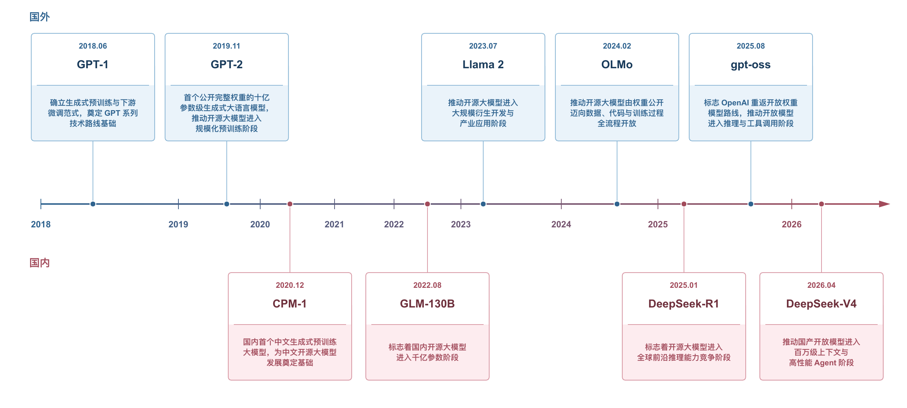

# 一、开源大模型发展现状

[本章目录](index.md) · [全书目录](../index.md) · [上一节](../chapter_introduction/04.md) · [下一节](../chapter_development-and-risks/02.md)

开源大模型的发展始于生成式预训练技术的探索，随后出现更大规模的开放模型，并逐步融合多模态能力，承担更复杂的任务。2018年，OpenAI发布GPT-1[[19]](../chapter_references/index.md#ref-19)，展示了将生成式预训练与下游任务微调结合的技术路径，随后GPT-2[[20]](../chapter_references/index.md#ref-20)通过开放模型权重进一步推动了相关技术的研究与应用。随着模型规模不断扩大，国内外开源大模型逐步进入快速发展阶段，以BLOOM[[21]](../chapter_references/index.md#ref-21)、GLM-130B[[22]](../chapter_references/index.md#ref-22)等为代表的模型推动开放模型迈入千亿参数规模，Llama[[3]](../chapter_references/index.md#ref-3)系列和Qwen[[2]](../chapter_references/index.md#ref-2)系列则通过持续迭代促进了模型性能提升和应用生态扩展。与此同时，Stable Diffusion[[23]](../chapter_references/index.md#ref-23)等模型推动生成能力从文本向图像和视频等多模态领域拓展，OLMo[[24]](../chapter_references/index.md#ref-24)等项目进一步探索训练数据与开发过程的全面开放。近年来，开源大模型的技术发展重点逐渐从基础生成能力向复杂推理与任务执行转变，DeepSeek-R1[[1]](../chapter_references/index.md#ref-1)、Qwen3[[7]](../chapter_references/index.md#ref-7)等模型显著提升了推理能力，Kimi K2[[25]](../chapter_references/index.md#ref-25)等模型则进一步推动了工具调用与智能体技术的发展。截至2026年，开源大模型已逐渐从单一模型的开放，发展为涵盖模型研发、共享分发和应用创新的技术生态。

图2-1 国内外开源大模型代表性发展节点

全球开源大模型发展主要由中国和美国引领。美国起步较早，在模型技术和开源生态建设方面具有先发优势。中国起步相对较晚，但DeepSeek[[1]](../chapter_references/index.md#ref-1)、Qwen等模型近年来快速迭代，与国际领先模型的性能差距逐渐缩小，部分模型在推理和代码生成领域已表现出较强竞争力。欧洲以Mistral[[26]](../chapter_references/index.md#ref-26)和OpenEuroLLM[[27]](../chapter_references/index.md#ref-27)等项目为代表，重点发展多语言能力与开放协作，非洲则通过Masakhane[[28]](../chapter_references/index.md#ref-28)等研究社区和InkubaLM[[29]](../chapter_references/index.md#ref-29)等模型，探索低资源本土语言的开发与应用。图2-1按时间顺序列出了2018年至2026年9月国内外代表性模型的发展节点。

图2-1进一步显示了各阶段的发展重点：早期以语言生成和预训练探索为主，2022年前后转向大参数规模与多模态能力，2025年以来DeepSeek-R1、DeepSeek-V4[[30]](../chapter_references/index.md#ref-30)等模型则推动复杂推理、混合专家架构和智能体应用发展。模型能力提升与开放范围扩大，也使安全治理需要从生成结果延伸至模型修改、二次开发和实际部署。

## （一）国外开源大模型发展趋势

国外开源大模型起步较早。早期模型开放主要服务于学术研究和方法验证，开放内容多集中于模型权重及相关代码。随着模型规模不断扩大，模型能力和开发工具持续完善，开放大模型逐步形成涵盖模型微调、部署以及应用开发的技术生态。近年来，推理能力、多模态能力和智能体能力进一步融入开放模型体系，模型的应用范围也随之扩大。

表2-1汇总了2018年至2026年具有代表性的开源大模型及模型系列，共11个代表性条目，主要展示发布时间、代表模型、发布机构、开放类型和开源协议。开放程度主要依据模型权重和代码是否公开，同时考察训练数据及训练过程的开放情况。

表2-1 国外代表性开源大模型及开放情况

| 时间 | 代表模型 | 发布机构 | 开放类型 | 开源协议 |
| --- | --- | --- | --- | --- |
| 2018年6月 | GPT-1[[19]](../chapter_references/index.md#ref-19) | OpenAI（美国） | Open-weight | MIT License[[31]](../chapter_references/index.md#ref-31) |
| 2019年2—11月 | GPT-2[[20]](../chapter_references/index.md#ref-20) | OpenAI（美国） | Open-weight | Modified MIT License[[20]](../chapter_references/index.md#ref-20) |
| 2022年7月 | BLOOM[[21]](../chapter_references/index.md#ref-21) | BigScience（国际协作） | Restricted Open | BigScience BLOOM RAIL 1.0[[21]](../chapter_references/index.md#ref-21) |
| 2022年8月 | Stable Diffusion[[23]](../chapter_references/index.md#ref-23) | Stability AI、CompVis、Runway（国际合作） | Restricted Open | CreativeML Open RAIL-M[[23]](../chapter_references/index.md#ref-23) |
| 2023年7月 | Llama 2[[32]](../chapter_references/index.md#ref-32) | Meta（美国） | Restricted Open | Llama 2 Community License[[32]](../chapter_references/index.md#ref-32) |
| 2023年12月 | Mixtral 8x7B[[33]](../chapter_references/index.md#ref-33) | Mistral AI（法国） | Open-weight | Apache-2.0[[34]](../chapter_references/index.md#ref-34) |
| 2024年2月 | OLMo[[24]](../chapter_references/index.md#ref-24) | Ai2（美国） | Fully Open | Apache-2.0[[34]](../chapter_references/index.md#ref-34)（模型及代码）；训练数据采用独立开放许可 |
| 2024年7月 | Llama 3.1 405B[[35]](../chapter_references/index.md#ref-35) | Meta（美国） | Restricted Open | Llama 3.1 Community License[[36]](../chapter_references/index.md#ref-36) |
| 2025年3月 | Gemma 3[[37]](../chapter_references/index.md#ref-37) | Google（美国） | Restricted Open | Gemma Terms of Use[[37]](../chapter_references/index.md#ref-37) |
| 2025年8月 | gpt-oss-20b / 120b[[38]](../chapter_references/index.md#ref-38) | OpenAI（美国） | Open-weight | Apache-2.0[[34]](../chapter_references/index.md#ref-34)；另适用gpt-oss Usage Policy[[38]](../chapter_references/index.md#ref-38) |
| 2026年3月 | Mistral Small 4[[39]](../chapter_references/index.md#ref-39) | Mistral AI（法国） | Open-weight | Apache-2.0[[34]](../chapter_references/index.md#ref-34) |

注：根据模型核心要素的实际开放范围，下面区分Fully Open、Open-weight和Restricted Open三类。Fully Open指模型权重、训练数据、训练代码及训练过程等核心要素实现较为系统的开放；Open-weight主要指模型权重可获取，并通常提供推理或微调所需代码；Restricted Open指模型权重或代码可以获取，但许可证或使用条款对用途、商业规模、访问资格或再分发方式等设置一定限制。同一条目列出的不同参数规模或型号合并展示。开源协议较为宽松并不意味着训练数据和完整训练过程同时公开。

GPT：2018年，OpenAI发布GPT-1，将Transformer[[40]](../chapter_references/index.md#ref-40)架构与生成式预训练方法结合，先开展大规模无监督预训练，再针对下游任务微调，验证了通用预训练模型可以迁移到不同的自然语言处理任务。OpenAI同时公开了相关模型和代码，并采用MIT许可证[[31]](../chapter_references/index.md#ref-31)，为研究者开展模型实验和下游任务适配提供了基础，但并未完整开放预训练数据和全部预训练过程。2019年，OpenAI进一步发布GPT-2，将模型规模扩大至15亿参数，并首次在开放模型时一并考虑潜在的滥用风险。GPT-2没有一次性发布完整模型，而是先后开放124M、355M和774M版本。OpenAI持续评估生成内容的滥用风险后，于2019年11月最终公开1.5B模型权重和代码。GPT-2的分阶段开放也成为早期模型风险治理的典型案例。此后，OpenAI在GPT-3[[41]](../chapter_references/index.md#ref-41)等模型上主要采用API方式提供能力，不再公开模型权重。直到2025年8月，OpenAI发布gpt-oss-120b[[38]](../chapter_references/index.md#ref-38)和gpt-oss-20b[[38]](../chapter_references/index.md#ref-38)，重新推出开放权重语言模型。两款模型采用Apache 2.0[[34]](../chapter_references/index.md#ref-34)许可证，突出复杂推理、工具调用和可调节推理强度，并支持开发者在自有基础设施上部署和微调。OpenAI将其定位为自GPT-2以来首次发布的开放权重语言模型，体现出其开放模式由早期模型和代码发布，经由封闭API服务，再重新转向开放权重推理模型的变化。

BLOOM：2022年，BigScience发布BLOOM。与主要由单一企业完成研发的大语言模型不同，BLOOM由来自多个国家和机构的研究人员共同参与开发，是大规模国际协作开展基础模型研发的代表性项目。模型参数规模达到1760亿，能够处理46种自然语言和13种编程语言，在当时属于规模最大的开放多语言模型之一。BigScience还将开放科学理念应用于研发，系统披露训练代码、模型检查点、训练配置和数据来源，使外部研究者能够了解模型从数据准备到训练的主要环节。同时，BLOOM采用专门设计的Responsible AI License[[42]](../chapter_references/index.md#ref-42)，将模型开放与使用约束结合起来，对部分高风险用途设置限制。这种做法表明，随着模型能力增强，大模型开放开始从单纯公开模型文件，进一步延伸到研发协作、过程透明和许可治理等方面。

Stable Diffusion：2022年8月，Stability AI联合CompVis、Runway等团队发布Stable Diffusion，将开放生成模型的影响范围从语言领域明显拓展至图像生成领域。Stable Diffusion基于潜空间扩散技术，在保持较高图像生成质量的同时降低了模型推理所需的计算资源，使开发者能够在消费级硬件或自有设备上运行和修改模型。模型权重及相关代码公开后，开发者可以围绕基础模型进行微调和二次开发，并由此形成模型微调、插件扩展和垂直应用等较为活跃的开放生态。与采用传统宽松开源许可证的项目不同，Stable Diffusion采用CreativeML Open RAIL-M[[23]](../chapter_references/index.md#ref-23)，在允许商业及非商业使用、修改和再分发的同时，对部分不当用途设置限制。Stable Diffusion由此成为开放生成式人工智能从语言模型扩展到视觉生成的重要节点，也使“开放权重+社区二次开发”的模式在多模态生成领域得到更广泛应用。

Llama：2023年7月，Meta发布Llama 2[[32]](../chapter_references/index.md#ref-32)系列模型，包括7B、13B和70B等参数规模，并向研究机构和大多数商业用户提供模型权重。相比此前主要面向研究用途开放的部分基础模型，Llama 2进一步扩大了开放权重模型的应用范围，使企业和开发者能够围绕基础模型开展本地部署、微调和行业应用开发。Llama 2发布后，大量量化模型、领域微调模型以及配套部署工具围绕其形成，推动开放权重模型由研究资源逐步转变为可直接用于应用开发的基础设施。2024年7月，Meta进一步发布Llama 3.1[[36]](../chapter_references/index.md#ref-36)，其中405B模型将开放权重模型扩展到超大参数规模，支持128K上下文和多语言能力，并允许开发者利用模型生成合成数据或进行模型蒸馏。Meta将Llama 3.1 405B[[35]](../chapter_references/index.md#ref-35)定位为首个达到前沿模型能力水平的开放模型之一。Llama系列的持续演进表明，开放权重模型已经不再局限于中小规模研究模型，而是逐渐进入与大型闭源模型竞争的能力区间，并围绕模型本身形成较为完整的开发生态。

Mixtral 8x7B[[33]](../chapter_references/index.md#ref-33)： 2023年12月，Mistral AI发布Mixtral 8x7B，将稀疏混合专家架构引入其开放权重模型体系。模型由多个专家网络组成，每次生成时只激活其中部分参数，在扩大模型总体容量的同时降低实际推理计算量。Mixtral 8x7B总参数约47B，每个Token实际激活约13B参数，并支持32K上下文。Mistral AI将模型权重以Apache 2.0许可证发布，允许开发者较自由地使用、修改和进行商业部署。相较于同时期采用专门社区许可证并设置商业限制的部分开放权重模型，Mixtral采用更加宽松的许可方式，也使其成为开放权重MoE模型的重要代表。Mixtral表明，开放模型可以通过架构创新提高计算效率和部署可用性，而不只依靠扩大参数规模。

OLMo：2024年2月，艾伦人工智能研究所（Ai2）发布OLMo，其核心特点是尽可能开放研发全过程。Ai2同时发布模型权重、预训练数据、训练代码和推理代码，并公开训练日志、训练指标以及大量中间检查点，还提供相应的评测和微调工具。其训练数据Dolma及相关数据处理资源也向研究社区开放。研究者可以直接使用模型，也可以分析不同训练数据和训练阶段对模型能力的影响。与主要采用Open-weight模式的模型相比，OLMo将开放范围进一步向训练过程和数据层延伸，使外部研究者能够对模型进行更深入的验证和复现。2024年以后，Ai2又通过OLMo 2[[43]](../chapter_references/index.md#ref-43)、OLMoE[[44]](../chapter_references/index.md#ref-44)等项目继续推进完整开放路线，并将开放范围延伸到MoE架构及后训练等环节。OLMo因此成为Fully Open模式最具代表性的模型系列之一，也体现出开源大模型生态中除开放权重之外的另一条发展路径，即通过提高研发全过程透明度支持基础模型研究。

Gemma 3[[37]](../chapter_references/index.md#ref-37)： Google于2024年启动Gemma[[37]](../chapter_references/index.md#ref-37)开放模型系列，并在2025年3月发布Gemma 3。Gemma 3提供1B、4B、12B和27B等不同参数规模，强调在相对有限计算资源上的部署能力，其中主要型号进一步支持文本和图像输入，并强化多语言、视觉理解和函数调用能力。Google同时提供量化版本及配套开发工具，以降低模型在本地设备和单GPU环境中的使用门槛。Gemma系列体现出大型基础模型厂商在封闭模型之外同步建设开放模型生态的趋势，即以较小参数规模和较低部署成本扩大模型能力的可获得性。不过，Gemma并未采用Apache 2.0或MIT等传统开源许可证，而是通过专门的Gemma Terms of Use[[37]](../chapter_references/index.md#ref-37)对模型使用及再分发进行规范，并结合禁止用途政策设置相应限制。因此，Gemma 3更适合作为Restricted Open模式的代表，其价值主要体现在多模态能力、轻量化部署与开放权重生态的结合。

Mistral Small 4[[39]](../chapter_references/index.md#ref-39)： 2026年3月，Mistral AI发布Mistral Small 4，进一步将开放模型的发展重点从单一语言生成能力推进到推理、多模态和智能体能力的融合。该模型采用混合专家架构，总参数规模为119B，每次推理激活约6.5B参数，并支持较长上下文。Mistral Small 4将Mistral此前分别面向推理的Magistral[[45]](../chapter_references/index.md#ref-45)、多模态的Pixtral[[46]](../chapter_references/index.md#ref-46)以及智能体编程的Devstral[[47]](../chapter_references/index.md#ref-47)等模型能力整合到同一模型中，使其能够同时面向通用对话、复杂推理、图像理解、代码生成和智能体任务。模型还支持函数调用、Agent工作流和内置工具等能力，说明开放模型开始从单纯提供文本生成接口进一步向任务执行型模型发展。Mistral Small 4继续采用Apache 2.0许可证，并公开模型权重，使开发者能够在本地部署和定制模型。这一模型反映了2026年前后国外开放模型的新趋势：推理能力、多模态理解和工具使用逐渐在同一基础模型中融合，开放模型也开始成为构建智能体系统的重要基础。

## （二）国内开源大模型发展趋势

国内开源大模型的探索可以追溯至2020年前后。早期模型主要围绕中文生成和语言理解展开，并通过开放模型参数和代码推动中文预训练模型研究。随着模型规模和通用能力不断提升，国内开放模型逐步由中文语言模型扩展到通用大语言模型，并进一步向复杂推理、多模态生成和智能体能力发展。近年来，开放权重逐渐成为国内基础模型扩大开发者生态的重要方式，模型的部署能力持续提升，应用范围也不断扩大。

表2-2汇总了2020年至2026年国内代表性开源大模型及模型系列，展示发布时间、代表模型、发布机构、开放类型和开源协议。开放程度的判断口径与表2-1一致，兼顾权重、代码、训练数据及训练过程的公开情况。

表2-2 国内代表性开源大模型及开放情况

| 时间 | 代表模型 | 发布机构 | 开放类型 | 开源协议 |
| --- | --- | --- | --- | --- |
| 2020年12月 | CPM-1[[48]](../chapter_references/index.md#ref-48) | 北京智源人工智能研究院、清华大学 | Restricted Open | MIT License[[31]](../chapter_references/index.md#ref-31)（代码）；模型面向研究开放 |
| 2022年8月 | GLM-130B[[22]](../chapter_references/index.md#ref-22) | 清华大学 | Restricted Open | Apache-2.0[[34]](../chapter_references/index.md#ref-34)（代码）；GLM-130B Model License[[22]](../chapter_references/index.md#ref-22)（模型） |
| 2023年3月 | ChatGLM-6B[[49]](../chapter_references/index.md#ref-49) | 清华大学、智谱AI | Restricted Open | Apache-2.0[[34]](../chapter_references/index.md#ref-34)（代码）；ChatGLM-6B Model License[[49]](../chapter_references/index.md#ref-49)（模型） |
| 2023年8月 | Qwen-7B[[2]](../chapter_references/index.md#ref-2) | 阿里云Qwen团队 | Restricted Open | Apache-2.0[[34]](../chapter_references/index.md#ref-34)（代码）；Tongyi Qianwen LICENSE AGREEMENT[[2]](../chapter_references/index.md#ref-2)（模型） |
| 2024年12月 | DeepSeek-V3[[50]](../chapter_references/index.md#ref-50) | 深度求索 | Restricted Open | MIT License[[31]](../chapter_references/index.md#ref-31)（代码）；DeepSeek Model License[[50]](../chapter_references/index.md#ref-50)（模型） |
| 2025年1月 | DeepSeek-R1[[1]](../chapter_references/index.md#ref-1) | 深度求索 | Open-weight | MIT License[[31]](../chapter_references/index.md#ref-31) |
| 2025年2月 | Wan2.1[[51]](../chapter_references/index.md#ref-51) | 阿里巴巴Wan团队 | Open-weight | Apache-2.0[[34]](../chapter_references/index.md#ref-34) |
| 2025年4月 | Qwen3-235B-A22B[[7]](../chapter_references/index.md#ref-7) | 阿里巴巴Qwen团队 | Open-weight | Apache-2.0[[34]](../chapter_references/index.md#ref-34) |
| 2025年7月 | Kimi K2[[25]](../chapter_references/index.md#ref-25) | 月之暗面 | Restricted Open | Modified MIT License[[25]](../chapter_references/index.md#ref-25) |
| 2026年7月 | Kimi K3[[52]](../chapter_references/index.md#ref-52) | 月之暗面 | Restricted Open | Kimi K3 License[[52]](../chapter_references/index.md#ref-52) |
| 2026年9月 | DeepSeek-V4.1-Flash[[30]](../chapter_references/index.md#ref-30) | 深度求索 | Open-weight | MIT License[[31]](../chapter_references/index.md#ref-31) |

注：开放类型的定义及划分标准与表2-1一致。同一条目列出的不同参数规模或型号合并展示。

CPM：2020年，北京智源人工智能研究院与清华大学联合推出CPM-1[[48]](../chapter_references/index.md#ref-48)，这是国内较早面向中文生成任务的大规模预训练语言模型，也是国内开源大模型探索的重要起点。CPM-1采用生成式预训练路线，参数规模达到26亿，重点面向中文文本生成以及少样本、零样本等任务。项目不仅开放模型参数，还陆续提供预训练、微调、文本生成和模型蒸馏等相关代码，使研究者能够围绕中文大规模预训练模型开展实验和二次开发。此后，CPM项目继续推出CPM-2[[53]](../chapter_references/index.md#ref-53)，在模型结构和训练效率方面进一步探索，并持续开放相关模型与代码。与后来主要面向通用对话和应用开发的开放模型相比，CPM系列更突出基础研究属性，较早建立了中文大规模预训练模型的开放研发路线，为后续研究提供了基础。

GLM：清华大学围绕General Language Model持续推进大规模预训练模型研究，并逐步形成从基础语言模型到对话模型的开放路线。2022年，GLM-130B发布，参数规模达到1300亿，面向中文和英文任务，并公开模型权重及相关推理和评测代码。项目同时探索INT4量化等技术，使百亿级以上模型能够在更有限的硬件条件下部署。2023年，基于GLM技术路线进一步推出ChatGLM-6B[[49]](../chapter_references/index.md#ref-49)。该模型将参数规模降低至62亿，并针对中文问答和对话场景进行优化，通过量化后可以在消费级显卡上本地运行，同时提供参数高效微调方案，显著降低开发者使用大语言模型的硬件门槛。ChatGLM此后持续迭代，推动国内开放大模型从面向研究的基础模型进一步走向对话应用和本地部署，也使GLM成为国内较早形成连续开放模型体系的技术路线之一。

Qwen：2023年8月，阿里云发布Qwen-7B[[2]](../chapter_references/index.md#ref-2)及Qwen-7B-Chat[[2]](../chapter_references/index.md#ref-2)，正式启动通义千问系列的开放模型路线。首批模型同时公开基础模型和经过对齐的对话模型权重，并提供推理、量化和微调工具，还支持长上下文及工具调用等能力。随后Qwen不断扩大参数规模和模型类型，逐渐形成覆盖不同尺寸基础模型以及代码、多模态等方向的开放模型体系。2024年的Qwen2[[54]](../chapter_references/index.md#ref-54)和Qwen2.5[[55]](../chapter_references/index.md#ref-55)进一步提升通用能力、代码能力以及多语言支持，开放模型的许可证也逐步趋于宽松。2025年发布的Qwen3进一步引入大规模MoE架构，其中Qwen3-235B-A22B[[7]](../chapter_references/index.md#ref-7)拥有2350亿总参数，每次推理激活220亿参数，并将思考模式与非思考模式整合到同一模型中。Qwen系列由早期7B级通用模型发展到大规模混合专家模型，体现出国内开源大模型从降低使用门槛向能力提升和完整开发生态建设持续演进的趋势。

DeepSeek：DeepSeek的开放模型路线在2024年至2026年间快速发展，并逐渐成为国内开源大模型的重要代表。2024年12月发布的DeepSeek-V3[[50]](../chapter_references/index.md#ref-50)采用MoE架构，总参数达到6710亿，每次推理激活370亿参数，并通过Multi-head Latent Attention和DeepSeekMoE等技术降低模型训练与推理成本。模型权重和相关代码同步开放，使大型MoE模型能够进入社区部署和二次开发体系。2025年1月，DeepSeek进一步发布DeepSeek-R1和R1-Zero[[1]](../chapter_references/index.md#ref-1)，将开放模型的发展重点推进到复杂推理领域。R1在后训练阶段大规模采用强化学习方法，并公开模型权重，允许利用模型输出进行蒸馏。这带动了大量小型推理模型和衍生模型的出现。2026年9月，DeepSeek发布V4.1-Flash[[30]](../chapter_references/index.md#ref-30)，将原生视觉理解纳入模型体系，并采用新的Causal Encoder–Decoder架构，在5520亿总参数下分别以较少激活参数处理输入和输出，同时进一步面向工具使用和智能体任务优化。DeepSeek由通用MoE模型发展到推理模型，再进一步走向原生多模态和智能体能力，体现出国内开放模型能力边界的快速扩展。

Wan：2025年2月，阿里巴巴开源Wan2.1[[51]](../chapter_references/index.md#ref-51)系列视频生成模型，将国内开放大模型生态进一步拓展到视频生成领域。Wan2.1同时支持文生视频和图生视频等任务，并提供不同参数规模的模型。其中1.3B版本将显存需求控制在消费级GPU可以承担的范围，使视频生成模型不再完全依赖大型服务器部署。项目还开放模型权重及推理代码，并采用Apache-2.0许可证，为开发者开展视频生成模型微调和应用开发提供了较为宽松的条件。相较于此前以语言理解和生成能力为主的开放模型，Wan2.1的意义在于进一步扩展了国内开放基础模型的模态范围，使开源生态从文本和图像理解逐步进入视频生成阶段。

Kimi：月之暗面的开放模型路线重点围绕大规模MoE、长上下文和智能体能力展开。2025年，Kimi K2开放模型权重，其总参数达到1万亿，每次推理激活320亿参数，并重点强化代码生成、工具调用和自主任务处理能力，使开放模型进一步从对话和推理向智能体应用延伸。在此基础上，Kimi又通过K2.5[[56]](../chapter_references/index.md#ref-56)和K2.6[[57]](../chapter_references/index.md#ref-57)等版本持续强化多模态理解以及长程任务执行能力。2026年7月发布的Kimi K3[[52]](../chapter_references/index.md#ref-52)进一步将模型规模扩大至2.8万亿参数，并原生支持视觉理解和百万Token上下文。模型面向长程编程、知识工作和复杂智能体任务进行设计，同时公开完整模型权重。Kimi系列的发展表明，国内开放模型正在由单轮生成能力进一步走向长上下文、多模态感知和持续任务执行，智能体能力也逐渐成为开放基础模型竞争的重要方向。

国内外开源大模型的发展方向正在逐步趋同，但在起步时间、开放方式和生态形成路径上仍存在一定差异。国外开源大模型起步较早，从GPT系列早期的模型与代码开放，到BLOOM的大规模国际协作，再到Llama、Mistral等开放权重模型形成广泛开发者生态，其发展过程经历了较长时间的技术积累。国内相关探索起步相对较晚，早期主要围绕中文预训练模型展开。2023年以来，随着Qwen、DeepSeek等模型持续迭代，国内开源大模型发展明显加快，在模型规模和综合能力方面逐步进入国际前沿水平。

从开放方式看，国外形成了更加多样的开放路径。部分模型以开放权重为主，通过社区许可证对使用范围作出约束；OLMo等项目则进一步公开训练数据和训练过程，探索更完整的开放模式。与此同时，BLOOM等项目还体现出跨机构协作和开放科学的发展特点。国内模型目前总体以开放权重为主，完整公开训练数据和训练过程的项目相对较少。早期部分模型对商业使用设置较多限制，近年来越来越多模型开始采用Apache 2.0或MIT等较为宽松的许可证，使模型开放逐渐从研究使用向商业部署和二次开发延伸。

在发展重点上，国外开源生态较早形成了基础模型、开发工具和社区应用相互促进的格局，并在语言生成之外较早拓展到图像生成等领域。国内开源大模型则表现出较强的快速迭代特点，在通用语言能力不断提升的基础上，很快向复杂推理和多模态能力延伸，智能体也成为新的重点方向。DeepSeek、Qwen等模型在MoE架构和推理能力方面持续推进，Wan等模型则将开放生态拓展到视频生成领域。随着国内外模型能力不断接近，双方的竞争重点正在由单纯追求参数规模和基础能力，逐步转向推理效率、部署成本和应用生态建设。

上述比较表明，国外较早形成企业、科研机构和开放社区共同参与的生态，国内则以企业快速迭代和开放权重为主要发展路径。双方正从不同起点走向相近方向，未来竞争将同时涉及模型性能、开放程度、开发者生态和实际应用能力。

## （三）开源大模型分发平台概述

开源大模型分发平台是指为大模型及其相关资源提供集中发布、存储、检索和下载服务的网络平台，连接着模型研发者与下游开发者。与传统开源软件主要依靠代码仓库进行传播不同，大使用模型通常需要获取权重及相应的配置文件，并了解其运行条件、许可要求和适用范围。因此，模型分发平台不仅承担资源存储和共享功能，还通过模型介绍、版本管理和开发工具支持，帮助开发者获取模型并开展后续应用。随着开源大模型规模扩大和衍生版本不断增加，分发平台逐渐成为支撑模型传播与生态协作的重要基础设施。

从平台形态看，开源大模型分发平台与传统开源社区既有联系，也存在区别。传统开源社区主要围绕代码开发和项目协作形成，模型分发平台则更重视大规模模型文件的管理及其后续使用。随着人工智能开发需求不断增加，两者的功能逐步融合。一方面，GitHub[[58]](../chapter_references/index.md#ref-58)等通用开源社区开始广泛承载模型相关项目，另一方面，Hugging Face Hub[[4]](../chapter_references/index.md#ref-4)等专业模型平台也不断完善社区交流和开发协作功能。此外，部分平台还将模型分发与数据管理、在线实验及算力服务相结合，形成综合性人工智能开发环境。目前国内外已形成一批具有代表性的平台，具体情况如表2-3所示。

从国际平台的发展情况看，不同平台依托自身的技术基础形成了各具特色的服务模式。Hugging Face Hub以模型仓库为核心，建立了相对完善的模型发布和共享机制。开发者可以通过模型卡[[59]](../chapter_references/index.md#ref-59)[[60]](../chapter_references/index.md#ref-60)了解模型用途、训练信息及使用限制，并借助相关开发工具直接下载或调用模型。GitHub则延续传统开源软件的协作方式，主要承担模型代码开发和项目维护功能[[61]](../chapter_references/index.md#ref-61)，模型权重通常通过其他平台提供。Kaggle Models[[62]](../chapter_references/index.md#ref-62)更重视模型与实验环境的结合，开发者可以在Notebook中直接使用相关模型，并共享实验过程，方便他人复现。这些平台分别在模型分发、代码协作和实验复现方面形成优势，共同构成国际开源大模型生态的重要支撑。

表2-3 国内外代表性开源大模型分发及协作平台

| 平台 | 平台定位 | 主要功能及特点 | 平台链接 |
| --- | --- | --- | --- |
| Hugging Face Hub[[4]](../chapter_references/index.md#ref-4) | 综合性模型社区与专业分发平台 | 提供模型托管、版本管理、模型下载及在线体验等服务。 | https://huggingface.co/ |
| GitHub[[58]](../chapter_references/index.md#ref-58) | 通用代码托管与开源协作平台 | 以代码托管和版本控制为核心，支持模型开发与开源协作。 | https://github.com/ |
| Kaggle Models[[62]](../chapter_references/index.md#ref-62) | 模型共享与实验协同平台 | 整合模型、数据集及在线计算环境，支持模型共享与实验复现。 | https://www.kaggle.com/models |
| ModelScope魔搭社区[[5]](../chapter_references/index.md#ref-5) | 综合性模型社区与开发平台 | 提供模型与数据集托管，支持模型微调、推理及应用展示。 | https://www.modelscope.cn/ |
| OpenXLab浦源[[63]](../chapter_references/index.md#ref-63) | 模型、数据与应用开放平台 | 提供模型、数据集及应用管理，支持资源下载与应用展示。 | https://openxlab.org.cn/ |
| OpenI启智社区[[64]](../chapter_references/index.md#ref-64) | 人工智能开源协作与算力服务平台 | 整合代码托管、数据管理与算力资源，支持模型开发和协作。 | https://www.openi.org.cn/ |

国内平台在借鉴上述发展模式的基础上，逐渐形成了各具特点的服务体系。ModelScope魔搭社区[[5]](../chapter_references/index.md#ref-5)以模型资源共享为基础，将模型下载与训练、推理工具相结合，并通过创空间支持开发者展示应用成果。OpenXLab浦源[[63]](../chapter_references/index.md#ref-63)围绕模型、数据集和应用建立资源管理体系，为人工智能研究成果的发布与共享提供服务。OpenI启智社区[[64]](../chapter_references/index.md#ref-64)则更加突出开发协作与计算资源的结合，使开发者能够在平台提供的环境中开展模型训练和推理。总体来看，国内外平台的基本功能正在逐步趋同，但发展侧重点仍有差异。国际代表性平台在专业化分发、开发者协作和实验复现方面形成了较为成熟的机制，国内平台则更加注重本土模型资源的汇聚，以及模型获取、开发工具和算力服务之间的衔接。

模型分发已形成持续更新和多次传播的过程。基础模型经微调、量化等操作后，可以产生面向不同任务和运行环境的衍生版本，再通过平台发布。同一基础模型因而可能对应不同权重精度和行业用途的衍生版本。部分平台利用模型卡、版本记录和基础模型关联信息说明这些关系，支持模型复用与后续扩展。

与此同时，模型分发平台的功能也在不断拓展。早期平台主要解决模型文件的存储与获取问题，如今则逐步向模型评测、在线体验和应用部署延伸。开发者不仅能够从平台下载模型，还可以通过在线环境测试模型效果，或利用平台提供的工具开展后续开发。这种变化降低了模型使用门槛，也增强了不同开发环节之间的联系。不过，随着模型在多个平台之间流转，跨平台版本识别和来源追踪的问题日益突出。同一模型可能同时存在官方发布版本、社区镜像和不同衍生版本，而各平台采用的标识和管理方式并不完全一致，增加了用户判断模型来源与版本关系的难度。

分发平台通过仓库管理、版本记录和信息披露支持模型共享，并借助访问管理和社区规则规范站内传播。但权重下载后仍可在平台外被复制、修改和再分发，平台难以全面控制后续使用。这一边界使模型分发有别于集中式在线服务，也影响后续风险处置方式。

[本章目录](index.md) · [全书目录](../index.md) · [上一节](../chapter_introduction/04.md) · [下一节](../chapter_development-and-risks/02.md)
