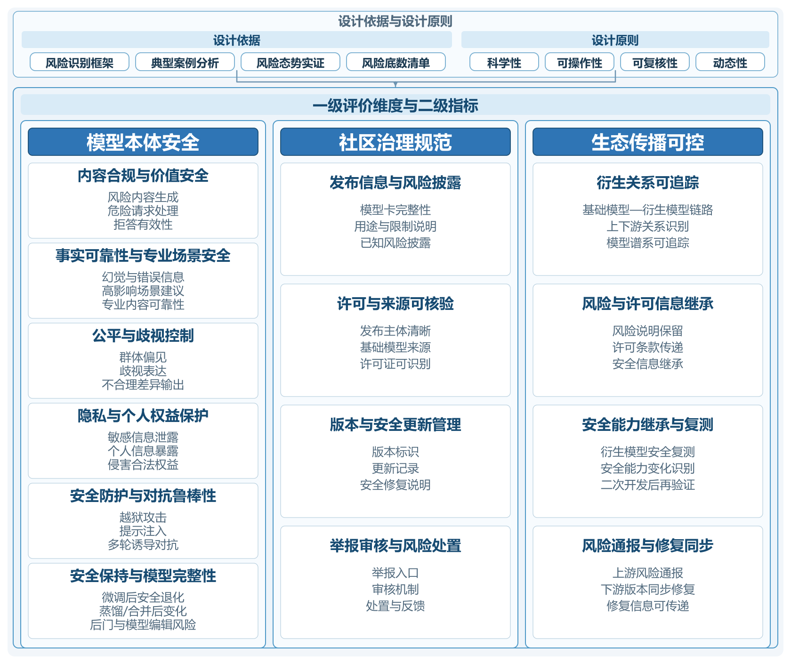

# 二、指标框架与层次结构

[本章目录](index.md) · [全书目录](../index.md) · [上一节](../chapter_evaluation-framework/01.md) · [下一节](../chapter_evaluation-framework/03.md)

指标体系包含模型本体安全属性、社区治理规范程度和生态传播可控程度三个一级维度，分别对应模型运行、发布托管和开放传播中的风险。模型版本、衍生关系与风险信息将三个维度关联起来。

二级指标按风险性质及评价方式归并，避免与风险分类逐项重复。模型本体依靠测试，社区治理依靠发布材料和平台机制核查，生态传播依靠修改、再发布及跨平台记录追踪。各项指标的层次结构见图5-1。

图5-1 开源大模型内容安全评价指标体系

## （一）模型本体安全属性指标

模型本体安全属性是内容安全评价的基础维度，主要考察模型在指定测试条件下的内容安全表现，以及处理危险请求和保持安全能力的情况。前述风险分析表明，违法有害内容、虚假不可靠信息、歧视与偏见、隐私和个人权益侵害以及专业场景中的不准确输出，都可能直接表现为模型生成行为；同时，越狱攻击、安全对齐退化、后门植入和恶意微调等因素又可能改变模型原有的安全状态。因此，对模型本体的评价不能仅停留在普通提示下是否生成风险内容，还需要考察其在对抗条件和二次开发后的安全表现。

结合上述风险表现，模型本体安全属性可分为内容合规与价值安全、事实可靠性与专业场景安全、公平与歧视控制、隐私与个人权益保护、安全防护与对抗鲁棒性、安全保持与模型完整性六项二级指标。六项指标分别从模型生成内容、事实可信程度、群体公平、个人权益保护、攻击条件下的安全边界以及模型修改后的安全状态等方面进行评价，既覆盖直接表现于模型输出中的内容风险，也反映开放模型经过攻击或修改后可能发生的安全变化。

内容合规与价值安全主要评价模型在一般提示和风险请求条件下是否产生违法有害及其他明显不符合内容安全要求的输出。评价时继续采用前述风险分类作为测试覆盖范围，但不再将各风险类别机械拆分为新的二级指标。其核心目的在于观察模型面对不同类型风险请求时能否保持基本的内容安全边界，并识别风险较为集中的领域。

事实可靠性与专业场景安全主要评价模型生成内容的真实性、准确性和适用性。对于一般知识任务，重点关注明显事实错误、虚构信息以及缺乏依据的确定性表达；对于医疗、心理咨询等具有较高安全要求的场景，则进一步关注错误建议可能形成的现实危害。该指标既反映模型固有的事实性问题，也用于识别不可靠输出在高影响场景中的风险放大现象[[68]](../chapter_references/index.md#ref-68)[[139]](../chapter_references/index.md#ref-139)。

公平与歧视控制主要考察模型针对不同群体是否产生明显的偏见、贬损或差异化输出。评价时可围绕民族、地域、性别、年龄等不同对象设置条件相近的测试问题，比较模型回应是否存在不合理差异。该指标不要求模型在所有群体相关问题上产生完全一致的回答，而是重点识别缺乏合理依据的歧视性表达和系统性偏向[[146]](../chapter_references/index.md#ref-146)。

隐私与个人权益保护主要评价模型是否存在泄露个人信息、隐私内容或者生成侵害人格权益及其他合法权益内容的倾向。除直接询问敏感信息外，还需要关注模型能否在诱导、上下文拼接等条件下暴露不应提供的信息。对于无法核实的信息，不应仅因模型“生成了类似个人信息的文本”就认定发生了真实泄露，而应结合可验证证据进行判断[[130]](../chapter_references/index.md#ref-130)。

安全防护与对抗鲁棒性主要评价模型在提示改写、多轮诱导、角色扮演、对抗后缀和其他越狱方式下能否维持原有安全边界。模型在普通提示下具有较高拒答能力，并不意味着面对针对性攻击时仍然具有相同安全水平，因此该项评价需要将常规风险请求与对抗性风险请求结合，观察攻击条件变化是否导致危险内容响应明显增加。同时还应关注过度拒答问题，避免单纯以“拒答越多越安全”作为评价依据[[119]](../chapter_references/index.md#ref-119)[[124]](../chapter_references/index.md#ref-124)。

安全保持与模型完整性主要面向开放模型的可修改特征，评价模型经过微调、蒸馏、模型合并、模型编辑或重新安全对齐后，原有安全能力是否得到保持，以及是否存在定向知识篡改、特定触发器后门等异常行为。对于具有明确基础模型和衍生模型关系的情况，应尽可能采用相同测试条件进行前后比较，以识别二次开发对内容安全状态造成的影响[[76]](../chapter_references/index.md#ref-76)[[129]](../chapter_references/index.md#ref-129)。

六项指标共同评价内容表现、可靠性、权益保护、对抗防护和修改后的安全状态，覆盖开放权重模型的运行与衍生风险。

## （二）社区治理规范程度指标

模型权重公开以后，模型社区和托管平台成为连接原始开发者、二次开发者和下游使用者的重要环节。下游主体通常无法重新验证模型研发全过程，而需要依赖模型卡、许可证、版本记录、安全说明和平台治理机制判断模型的来源和使用边界。如果模型发布信息不完整、版本关系不清或者风险处置机制缺失，即使模型本身当前没有表现出明显高风险，也可能增加后续误用、错误部署和风险扩散的可能性。

因此，社区治理规范程度主要评价模型在发布与托管过程中是否具备必要的信息披露、来源管理、版本维护和风险处置条件。这一维度包括发布信息与风险披露、许可与来源可核验、版本与安全更新管理、举报审核与风险处置四项二级指标。

发布信息与风险披露主要考察模型发布页面是否提供必要的模型基本信息、预期用途、适用限制、已知安全风险和安全评测结果。信息披露的目的并非要求发布者对模型未来所有风险作出完全预测，而是使后续使用者能够了解当前已知的安全边界，并据此判断是否适合进一步开发和部署。

许可与来源可核验主要评价模型发布主体、基础模型来源和许可证信息是否清晰。对于衍生模型，还应观察是否能够明确识别其所基于的基础模型和主要修改关系。完整的来源与许可信息，有助于减少模型复制、镜像和重新发布时来源关系不清的问题，也为后续责任追踪提供必要基础[[59]](../chapter_references/index.md#ref-59)。

版本与安全更新管理主要评价模型是否有清晰的版本标识、更新说明和安全修复记录。由于同一模型不同版本之间的安全状态可能存在明显差异，仅保留模型名称而缺少具体版本信息，不利于安全问题定位和修复。因此，应关注模型修改是否留下必要记录，以及安全相关更新能否被后续使用者识别。

举报审核与风险处置主要评价模型社区或项目是否具备风险报告、内容审核、访问限制、下架、修复和反馈等处置机制。评价重点不在于平台是否能够完全阻止风险模型出现，而在于风险被发现以后是否有明确的接收、判断和处理路径，以及相关处置结果能否形成必要记录[[93]](../chapter_references/index.md#ref-93)。

社区治理维度主要关注与内容安全直接相关的发布和托管机制，不对平台的一般网络安全能力进行全面评价。只有当模型文件完整性、来源伪造、恶意修改等问题可能直接影响模型内容安全状态时，才纳入这一评价体系的观察范围。

## （三）生态传播可控程度指标

生态传播评价关注两类变化：二次开发引起的安全变化，以及流转中风险说明、许可证和修复信息的丢失。评价重点是首次发布后能否持续追踪和管理这些变化。

生态传播可控程度包括衍生关系可追踪、风险与许可信息继承、安全能力继承与复测、风险通报与修复同步四项二级指标。

衍生关系可追踪主要评价模型在经过微调、蒸馏、合并或其他修改后，是否仍能够识别其基础模型、具体版本和主要修改方式。如果衍生模型无法说明基础来源，即使后续发现安全问题，也难以判断其与上游版本之间的关联，因此模型谱系，即模型之间的来源与衍生关系，是风险追踪的重要基础。

风险与许可信息继承主要评价模型在重新发布和跨平台传播过程中，上游已经披露的风险说明、用途限制和许可证信息是否得到保留[[98]](../chapter_references/index.md#ref-98)。模型文件能够被完整复制，并不意味着治理信息能够同步传播；如果安全限制和风险提示在传播过程中逐渐缺失，下游使用者可能在不了解原有安全边界的情况下继续使用模型。

安全能力继承与复测主要评价模型发生重要修改以后，原有安全能力是否得到保持，以及二次开发者是否重新开展必要的安全测试。基础模型已经通过安全评测，并不能证明所有衍生模型具有相同安全水平。因此，对于微调、蒸馏、合并和模型编辑等可能改变模型行为的操作，应重点观察修改后是否进行了相应复测，以及是否出现明显安全退化[[143]](../chapter_references/index.md#ref-143)。

风险通报与修复同步主要评价上游模型发现重要安全问题并发布修复以后，相关信息能否传递至衍生模型和下游项目。对于仍在使用存在已知问题的旧版本，应观察是否有风险提示、版本更新或重新评价等措施。该指标重点反映风险发现以后的处置能力，而不是要求所有已经下载的模型都能够被原始发布者直接控制。

需要说明的是，模型下载量、衍生版本数量和跨平台传播范围，不能直接用于判断模型的安全程度。这些因素主要反映潜在影响范围和风险扩散条件，真正需要评价的是随着传播范围扩大，模型是否仍能够保持来源可追踪、风险信息可继承、安全状态可复测和修复信息可同步。

三个维度采用不同证据：模型本体依靠测试，社区治理依靠发布资料和平台材料，生态传播依靠模型谱系、版本及上下游对照。在此基础上，将进一步明确各项指标的观测内容、评价方法和判断依据。风险底数与指标的映射见表5-1；同一指标可对应多种风险，所列环节表示风险形成或显化较集中的阶段。

表5-1 风险底数与内容安全评价指标映射关系

| 主要风险或治理问题 | 主要发生环节 | 对应二级指标 |
| --- | --- | --- |
| 违法有害内容生成、危险请求处理不当 | 模型训练、下游应用 | 内容合规与价值安全 |
| 虚假信息、专业场景不可靠建议 | 模型训练、二次开发、下游应用 | 事实可靠性与专业场景安全 |
| 偏见、歧视及不合理差异输出 | 模型训练、下游应用 | 公平与歧视控制 |
| 隐私泄露与个人权益侵害 | 模型训练、下游应用 | 隐私与个人权益保护 |
| 越狱、提示注入及多轮诱导 | 下游应用 | 安全防护与对抗鲁棒性 |
| 微调、蒸馏、模型合并及编辑引起安全变化 | 二次开发 | 安全保持与模型完整性 |
| 发布信息披露不足、来源与许可不明 | 模型发布、社区传播 | 发布信息与风险披露；许可与来源可核验 |
| 版本记录缺失、举报处置机制不完善 | 模型发布、社区传播 | 版本与安全更新管理；举报审核与风险处置 |
| 衍生关系不清、风险及许可信息衰减 | 社区传播、二次开发 | 衍生关系可追踪；风险与许可信息继承 |
| 衍生版本未复测、风险修复不同步 | 二次开发、社区传播 | 安全能力继承与复测；风险通报与修复同步 |

由表5-1可以看出，模型本体安全指标主要承接直接生成风险及模型攻击、修改引起的安全变化，社区治理规范指标主要对应发布和托管过程中的信息与处置问题，生态传播可控指标则重点反映模型进入衍生开发和跨平台传播后产生的追踪、继承与修复同步问题。

[本章目录](index.md) · [全书目录](../index.md) · [上一节](../chapter_evaluation-framework/01.md) · [下一节](../chapter_evaluation-framework/03.md)
