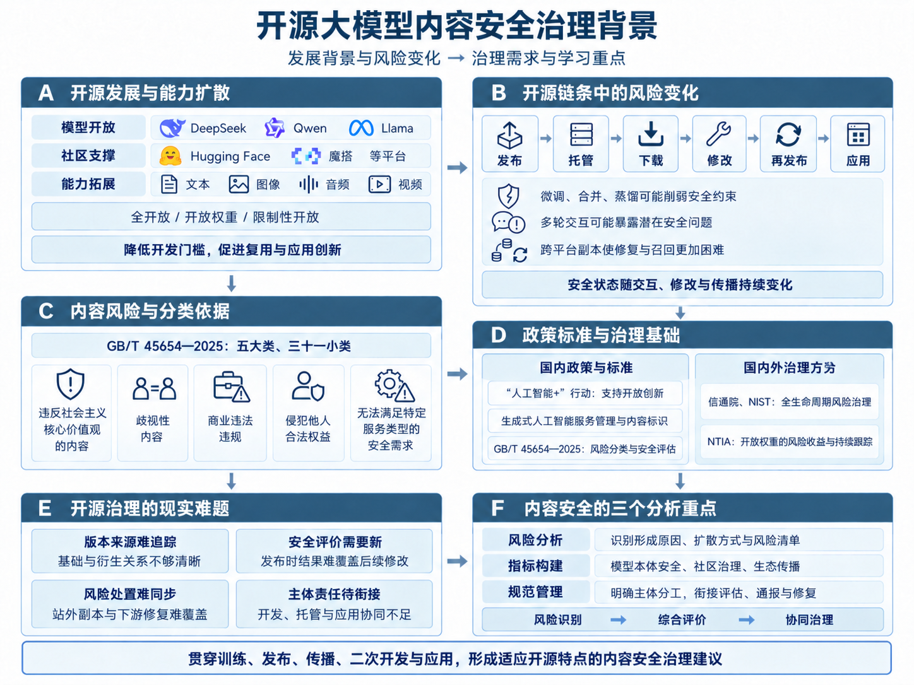

# 一、学习背景

[本章目录](index.md) · [全书目录](../index.md) · [下一节](../chapter_introduction/02.md)

近年来，开源大模型已成为推动人工智能技术创新和应用的重要力量。以DeepSeek[[1]](../chapter_references/index.md#ref-1)、Qwen[[2]](../chapter_references/index.md#ref-2)、Llama[[3]](../chapter_references/index.md#ref-3)等为代表的模型家族陆续公开模型权重、配套代码和开发工具，企业、高校及个人开发者得以在已有成果基础上研究技术、开发应用。DeepSeek-R1[[1]](../chapter_references/index.md#ref-1)在发布推理模型的同时，提供了基于Qwen和Llama训练的蒸馏模型，体现了开源协作促进模型复用和技术传播的作用。另外，Hugging Face[[4]](../chapter_references/index.md#ref-4)、魔搭（ModelScope）[[5]](../chapter_references/index.md#ref-5)等模型社区和托管平台，为模型共享和开发协作提供了支持。随着模型能力持续向文本、图像、音频和视频等模态拓展，人工智能生成内容的形式更加丰富，传播链条与应用场景也日趋复杂。

这里的“开源大模型”采用广义口径，既包括较完整公开训练数据、训练代码、模型参数和技术文档的全开放（Fully Open）模型，也包括允许下载参数并进行本地部署或微调的开放权重模型，以及采用自定义许可证、对商业规模、用途或再分发方式设置一定限制的模型。不同模型在权重、代码、数据和许可证等方面的开放程度并不相同，但都促进了模型能力传播、模型复现和二次开发。

开源模式降低了大模型的使用和开发门槛，也使内容安全风险更容易随模型传播而扩散。模型发布后，开发者可以在本地部署，开展微调、合并或蒸馏，并再次向外发布。原有的安全训练和内容过滤措施未必能在这些过程中完整保留，某一版本的安全评测结果也未必适用于修改后的模型。一旦模型被大量下载并转存至不同平台，原开发机构即使修复问题、更新版本，托管平台即使采取下架措施，也难以同步处理已经流出的模型副本。如何掌握模型的来源和修改情况，及时发现风险并通知下游使用者，由此成为开源大模型治理中的现实难题。

近年的公开研究表明，开源大模型的内容安全状况会随实际交互方式和后续开发过程变化。2025年11月，思科公布了针对八款开放权重模型的安全测试结果[[6]](../chapter_references/index.md#ref-6)，其中包括Qwen3-32B[[7]](../chapter_references/index.md#ref-7)、DeepSeek-V3.1[[8]](../chapter_references/index.md#ref-8)和Llama-3.3-70B-Instruct[[9]](../chapter_references/index.md#ref-9)。研究发现，多轮对话能够诱发单轮测试中未充分暴露的安全问题，涉及虚假信息、操纵性内容和恶意代码等。2026年1月，《自然》发表的一项研究[[10]](../chapter_references/index.md#ref-10)发现，针对不安全代码生成任务进行微调，可能使模型在其他领域的回答中出现有害建议或欺骗性内容。这些研究说明，对开源大模型的安全评价需要考虑实际交互过程和后续修改，不能只依据发布时的测试结果。

现有大模型安全研究为开源环境下的内容风险分析提供了重要基础。360《大模型安全白皮书》[[11]](../chapter_references/index.md#ref-11)将内容安全置于大模型整体安全体系中，强调外部防护与平台自身安全能力相结合。对开源大模型而言，违法有害信息、歧视性内容、虚假信息以及侵害个人权益的内容，既可能与训练数据和模型能力有关，也可能由后续微调、知识库接入和应用配置不当引起。内容审核因而需要覆盖模型开发和应用的不同环节。

目前，国内外相关研究已逐步形成面向全生命周期的人工智能安全治理思路。中国信息通信研究院《人工智能安全治理研究报告（2025年）》[[12]](../chapter_references/index.md#ref-12)强调结合应用场景开展风险评估，通过技术防护、制度建设和行业协作落实安全要求。美国国家标准与技术研究院（NIST）发布的生成式人工智能风险管理配套文件[[13]](../chapter_references/index.md#ref-13)，关注组织管理、发布前测试、内容来源和安全事件披露等环节。美国国家电信和信息管理局（NTIA）则专门研究模型权重公开发布的影响[[14]](../chapter_references/index.md#ref-14)，提出在比较开源与闭源模式风险和收益的基础上，持续跟踪风险变化。这些研究为治理提供了参考，但将一般性要求落实到开源大模型的整个生命周期，还需要解决具体问题。例如，谁来评估衍生模型，平台如何处置站外流传的风险版本，以及各方如何共同推动模型的安全修复，都难以仅靠单一主体解决。

我国在推动开源大模型创新发展的同时，也在持续完善生成式人工智能治理制度。国务院《关于深入实施“人工智能+”行动的意见》[[15]](../chapter_references/index.md#ref-15)提出支持人工智能开源社区建设，促进模型、工具和数据集开放，并加强风险评估和安全保障。《生成式人工智能服务管理暂行办法》[[16]](../chapter_references/index.md#ref-16)坚持发展和安全并重，对向境内公众提供生成式人工智能服务的活动提出管理要求。《人工智能生成合成内容标识办法》[[17]](../chapter_references/index.md#ref-17)进一步明确了内容生成、传播等环节的标识要求。GB/T 45654—2025《网络安全技术 生成式人工智能服务安全基本要求》[[18]](../chapter_references/index.md#ref-18)则为训练语料和生成内容的安全评估提供了分类依据。理解开源大模型的规范管理，需要参考这些制度和标准，并结合研发、发布、托管和应用等不同活动，分析各项要求的适用范围及有关主体的责任。

认识内容安全风险，可以从GB/T 45654—2025《网络安全技术 生成式人工智能服务安全基本要求》提出的五大类、三十一小类安全风险入手，分析开源大模型内容风险的形成与扩散机制，重点考察二次开发和社区传播对风险的影响。在此基础上，学习模型安全评价指标，理解开发机构、托管平台和下游应用单位的协作分工，提出有针对性的管理建议。相关背景与分析重点见图1-1。

图1-1 开源大模型内容安全治理背景

[本章目录](index.md) · [全书目录](../index.md) · [下一节](../chapter_introduction/02.md)
