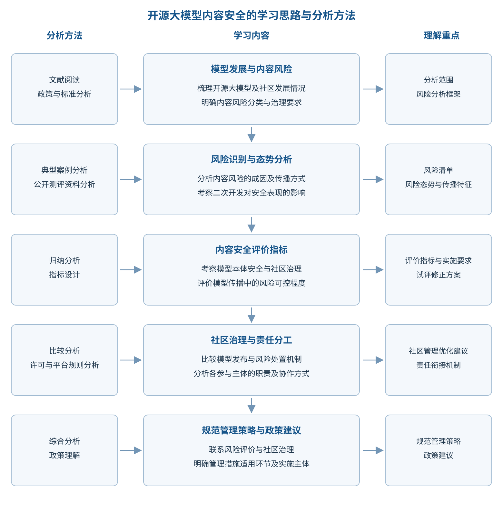

# 三、学习思路与分析方法

[本章目录](index.md) · [全书目录](../index.md) · [上一节](../chapter_introduction/02.md) · [下一节](../chapter_introduction/04.md)

学习内容从发展现状和风险识别入手，再进入评价指标与社区治理，逐步理解规范管理的方法。分析范围覆盖模型从训练到应用的全过程，重点关注二次开发引起的安全变化及社区传播中的风险扩散，学习思路与分析方法见图1-2。评价框架涵盖模型本体安全、社区治理规范和生态传播可控三个维度，使风险评价与治理措施相互衔接。

图1-2 内容安全的学习思路与分析方法

首先，阅读国内外相关文献、政策法规和技术标准，理解内容安全风险的分类依据及主要治理要求。比较不同方法的关注重点、评价条件和适用范围，有助于判断它们能否用于开源大模型。

其次，结合典型案例、公开测评资料与第三方平台测试理解风险。案例帮助解释风险如何产生，以及二次开发或应用环境如何影响风险；公开测评资料呈现不同条件下的模型安全表现，平台测试记录特定模型在给定条件下的得分。解读结果时，应核对模型版本和测试条件，再归纳风险的共同特征、整理风险清单。

在此基础上，比较国内外模型社区和托管平台的管理实践，分析开源许可与平台规则如何影响模型使用及风险处置。围绕模型来源追踪和安全信息传递，理解基础模型开发者与下游使用者之间的责任衔接，掌握可供借鉴的治理措施。

最后，将风险分析与社区治理联系起来，学习评价指标、实施要求、所需资料及主要判断依据，理解试评和修正的基本流程。学习管理措施时，还应明确其适用环节和实施主体，判断如何在具体活动中执行。

[本章目录](index.md) · [全书目录](../index.md) · [上一节](../chapter_introduction/02.md) · [下一节](../chapter_introduction/04.md)
