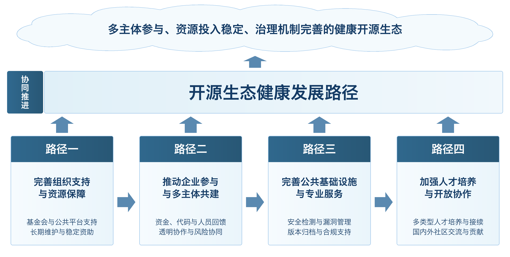

# 四、开源生态健康发展路径

[本章目录](index.md) · [全书目录](../index.md) · [上一节](../chapter_open-source-governance/03.md) · [下一节](../chapter_management-strategies/01.md)

开源生态的健康发展不仅取决于单个项目或社区的治理能力，还受到组织支持、资源投入、公共服务和人才供给等多方面因素影响。随着开源软件逐渐成为数字基础设施的重要组成部分，一些项目的维护任务和安全责任，已经超出个人开发者或小型团队能够长期承担的范围。因此，需要在保持开放协作优势的基础上进一步强化组织保障，扩大社会参与，同时完善公共服务和人才支持，逐步形成能够支撑项目持续运行的生态体系。结合当前开源生态面临的主要问题，可以从组织与资源保障、企业参与、公共服务以及人才协作四个方面推进建设，具体发展路径见下图。

图6-1 开源生态健康发展路径图

完善组织支持与资源保障。开源项目往往起步于个人开发者或小型团队，但随着用户增加和应用范围扩大，项目维护已经不再局限于技术开发，还需要承担安全响应、社区协调和相关治理工作。如果这些任务长期集中在少数核心维护者身上，容易出现维护能力与项目影响范围不匹配的问题。因此，应进一步发挥开源基金会和专业组织的作用，为重要项目提供组织托管和治理支持，帮助项目明确维护职责和成员参与方式，并完善重要事项的决策程序。对于规模较小的项目，可以依托公共平台和社区支持计划提供基础服务，降低维护者在技术工作之外承担的额外成本。

与此同时，还应提高资源投入的稳定性。对于被广泛使用的基础性开源项目，可以探索由基金会、企业和公共机构共同提供长期支持，为日常维护和安全修复提供更稳定的资金与人员保障。资源配置不宜单纯依据项目热度，而应更多考虑实际使用范围、维护压力和公共价值。资助过程也应提高透明度，避免项目长期依赖单一主体。还需要为核心维护工作安排后续人选，做好权限交接，并加强技术资料留存，降低因人员退出导致项目运行中断的风险。

推动企业参与与多主体共建。企业既是开源成果的重要使用者，也是生态建设的重要参与者。在利用开源项目提升开发效率的同时，企业应根据自身对项目的依赖程度，以适当方式回馈上游社区。除了资金支持，也可以通过投入开发人员或提交代码等方式参与项目维护。企业在实际应用中形成的通用改进，应尽可能反馈到社区版本，减少内部版本与上游项目长期分化造成的重复维护。与此同时，企业还应逐步完善内部开源管理，将开源组件使用和许可证审查纳入日常流程，并形成稳定的社区参与机制。

对于企业主导的开源项目，应进一步扩大外部成员参与，公开贡献规则和版本规划，提高重要决策过程的透明度。项目不宜长期依赖单一企业的资源和内部决策，而应通过持续吸收外部贡献增强自身稳定性。在此基础上，可以进一步加强企业与基金会、科研机构和专业安全组织之间的协作。当项目出现重大安全问题或来源争议时，各主体之间应及时共享信息并推动修复，使上游维护和下游应用能够更好衔接。

完善公共基础设施与专业服务。开源生态的运行不能只依赖代码托管平台，还需要更完善的公共服务能力。应为个人维护者和中小社区提供便利的安全检测工具及测试环境，降低开展基础安全工作的门槛。对于使用范围较广的开源组件，可以加强依赖关系识别，使漏洞信息能够及时传递到相关项目和使用者。与此同时，还应加强重要代码和历史版本的长期保存，避免项目停止维护或平台发生变化后关键资源难以获取。

公共基础设施还需要专业服务的支持。围绕许可证兼容和知识产权等复杂问题，可以发展面向开源领域的法律咨询与合规服务，帮助社区和企业降低理解规则的成本。安全机构则可以为重要项目提供专业评估，提高发现和处置风险的能力。不同平台之间还应加强项目信息和漏洞信息的衔接，使风险记录更加完整。随着开源范围不断扩大，模型和数据集等新型资源也逐渐进入开源生态，因此还需要结合其自身特点完善来源说明和版本管理，避免简单沿用传统软件的管理方式。

加强人才培养与开放协作。开源生态要实现长期发展，需要形成稳定的人才供给。高校和企业可以通过课程建设和实践项目，让参与者在学习技术开发的同时了解开源贡献流程和基本规则，使其能够更快进入真实项目。社区也应完善项目文档和贡献指引，并通过入门任务和导师支持降低参与门槛，帮助新成员逐步从一般贡献者成长为稳定的项目维护者。

人才培养还需要与开放协作相结合。社区不仅要重视代码贡献，也应认可文档维护和社区治理等工作，为不同类型的参与者提供持续成长的空间。对于长期参与项目的成员，可以建立较为清晰的维护者遴选和职责承接机制，增强人员接续能力。同时，国内开源社区还应保持与国际项目的交流，支持开发者持续参与国际社区，在实际协作中学习成熟项目的治理经验。通过长期参与和联合开发，可以逐步提升本土开源项目的持续维护能力，也有助于推动国内参与者由开源成果使用者向生态贡献者转变。

四条路径相互支撑：组织与资源保障稳定维护，企业参与扩大投入，公共服务降低成本，人才协作保障后续人员能够接手。协同推进可减少对少数维护者和单一组织的依赖，增强生态的持续运行与治理能力。

[本章目录](index.md) · [全书目录](../index.md) · [上一节](../chapter_open-source-governance/03.md) · [下一节](../chapter_management-strategies/01.md)
