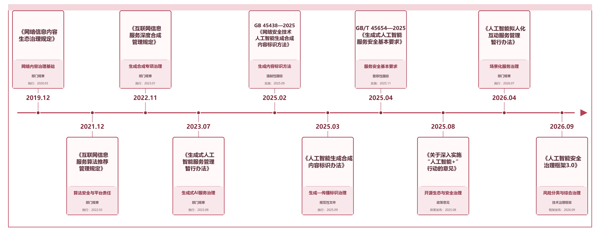

# 二、国内治理方法的发展

[本章目录](index.md) · [全书目录](../index.md) · [上一节](../chapter_research-progress/01.md) · [下一节](../chapter_research-progress/03.md)

相较于国外较早从人工智能伦理原则和风险治理框架展开研究，我国生成式人工智能治理研究更多是在网络内容治理、算法治理和平台责任等既有制度基础上，随着深度合成和大模型技术发展逐步扩展形成。现有研究大体可以归纳为生成式人工智能监管政策、网络内容治理两个方向：前者重点讨论生成式人工智能服务的法律定位、责任主体和分类监管，网络内容治理研究则逐渐由传统违法和不良信息识别，扩展至大模型安全评测与对抗测试。

## （一）生成式人工智能监管政策

随着生成式人工智能由技术研发快速进入内容生产、知识服务和社会应用领域，我国相关治理研究逐渐由传统网络信息内容管理和算法治理扩展至生成式人工智能的模型、数据、服务和内容传播等环节。与单纯针对某一技术风险设置监管规则相比，国内研究更加关注生成式人工智能产业链条中不同主体的法律定位、责任边界以及发展与安全之间的协调问题。张凌寒[[99]](../chapter_references/index.md#ref-99)从生成式人工智能的技术和产业结构出发，指出其呈现“基础模型—专业模型—服务应用”的分层业态，传统“技术支持者—服务提供者—内容生产者”的治理框架难以完全适配，并据此提出针对不同层次配置差异化治理工具的分层治理思路。钭晓东[[100]](../chapter_references/index.md#ref-100)则从数据安全角度分析生成式人工智能在数据输入、运算、存储和输出全过程中可能产生的风险，提出以风险管控、算法透明、多层次数据管理以及技术、标准和法律协同为基础的回应型治理思路。相关研究将监管分析由单一内容或算法行为扩展至模型、数据与应用之间的关系。

从制度演进看，我国生成式人工智能监管是在既有网络内容治理和算法治理制度的基础上逐步扩展形成的。2019年发布、2020年施行的《网络信息内容生态治理规定》[[101]](../chapter_references/index.md#ref-101)已经形成违法信息、不良信息及平台内容治理相结合的制度框架，并要求网络信息内容服务平台建立信息发布审核、实时巡查、应急处置和举报等治理机制。2022年施行的《互联网信息服务算法推荐管理规定》[[102]](../chapter_references/index.md#ref-102)进一步将“生成合成类”纳入算法推荐技术范围，要求相关服务提供者建立算法机制机理审核、科技伦理审查、信息审核、数据安全、安全评估监测和应急处置等制度，并根据服务舆论属性、社会动员能力、用户规模、数据重要程度和对用户行为的干预程度实行分级分类管理。这一阶段主要确立了网络内容分类、平台主体责任以及算法安全管理等基础制度，为后续生成式人工智能专项治理提供了制度基础。

随着深度合成技术广泛应用，监管对象进一步由一般算法机制向人工智能生成内容及其技术提供过程延伸。《互联网信息服务深度合成管理规定》[[103]](../chapter_references/index.md#ref-103)自2023年1月施行，将利用深度学习、虚拟现实等生成合成技术提供互联网信息服务的活动纳入专项治理范围，并从用户输入、合成结果、训练数据、技术安全和生成内容标识等方面设置相应要求。对于具有舆论属性或者社会动员能力的深度合成服务提供者及技术支持者，还设置了算法备案、安全评估等要求。这一制度变化意味着我国人工智能内容治理开始由传统的“发布后内容处置”进一步向生成技术本身及其服务过程延伸，形成覆盖输入、生成和传播环节的治理链条，也为随后生成式人工智能服务的专门监管提供了直接制度基础。

2023年实施的《生成式人工智能服务管理暂行办法》[[16]](../chapter_references/index.md#ref-16)进一步确立了面向公众提供生成式人工智能服务的专门治理框架。该办法明确以“利用生成式人工智能技术向中华人民共和国境内公众提供生成文本、图片、音频、视频等内容的服务”为主要适用对象，同时规定企业、高校和科研机构等研发、应用生成式人工智能技术但未向境内公众提供服务的活动不适用该办法。在治理理念上，《暂行办法》强调发展和安全并重、促进创新与依法治理相结合，并提出对生成式人工智能服务实行包容审慎和分类分级监管；在具体要求上，则涉及生成内容安全、训练数据和数据来源、个人信息和知识产权保护、生成内容标识、投诉举报以及违法内容处置等方面。由此，我国生成式人工智能治理由针对算法和深度合成技术的专项规则进一步发展为以生成式人工智能服务为对象、兼顾模型训练和下游服务活动的综合治理体系。

围绕《暂行办法》的实施，国内学术研究进一步关注传统平台治理框架能否适应生成式人工智能的技术结构。分层研究强调，基础模型开发者、专业模型提供者和终端服务商职能不同，需要分别配置责任。张凌寒据此提出“基础模型—专业模型—服务应用”的分层治理体系，分别强调基础模型层的发展导向、专业模型层的审慎监管以及服务应用层的敏捷治理。另一类研究则从数据、个人信息和生成内容风险出发，强调生成式人工智能治理具有明显的动态性和跨环节特征，需要通过风险评估、透明机制以及法律、标准和技术措施协同实现持续治理。这些研究使国内生成式人工智能监管研究逐渐由“某项规则是否适用”进一步转向“不同技术层级和风险环节应如何配置责任”的讨论。

2025年以来，我国生成式人工智能监管进一步向内容标识和传播环节细化。《人工智能生成合成内容标识办法》[[17]](../chapter_references/index.md#ref-17)自2025年9月施行，将人工智能生成合成内容标识划分为显式标识和隐式标识，并分别对生成服务提供者、内容传播服务平台和用户提出相应标识、核验和声明要求，同时禁止恶意删除、篡改、伪造和隐匿标识。这一制度将治理重点进一步从“模型是否生成有害内容”扩展至“生成内容能否被识别及其传播过程能否被追踪”，使生成端与传播端之间形成更加明确的责任衔接。不过，《标识办法》的直接适用对象仍然是符合有关规定的网络信息服务提供者及生成合成内容，并不能据此将模型权重文件本身直接认定为需要进行内容标识的对象。

与此同时，我国人工智能政策开始更明确地将创新发展、开源生态建设和安全治理放在同一政策框架中。2025年国务院《关于深入实施“人工智能+”行动的意见》[[15]](../chapter_references/index.md#ref-15)明确提出“促进开源生态繁荣”，支持人工智能开源社区建设以及模型、工具和数据集等汇聚开放，同时要求完善人工智能应用发展的安全治理环境。2026年，全国网络安全标准化技术委员会发布《人工智能安全治理框架3.0》[[104]](../chapter_references/index.md#ref-104)，继续沿用“风险分类、技术应对、综合治理”的核心逻辑，并结合人工智能发展变化对风险分类和治理措施进行更新。需要注意的是，该框架属于技术治理参考，并非直接设定行政许可或者处罚义务的法律规范。同年施行的《人工智能拟人化互动服务管理暂行办法》[[105]](../chapter_references/index.md#ref-105)则针对向公众提供持续性情感互动的特定人工智能服务进一步提出内容安全、未成年人保护、风险预警和全生命周期安全管理要求，但知识问答、工作助手、学习教育等不涉及持续性情感互动的服务并不当然适用该办法。这些制度变化反映出国内人工智能治理正在由一般生成式服务规则继续向具体应用场景和风险类型细化。

上述制度使监管从已发布内容的处置，逐步覆盖训练数据、生成、服务、标识和传播，并重视技术层级与责任主体的差异。然而，现有制度大多仍以具体的网络信息服务活动及其提供者为主要规范对象，公开模型权重、社区托管、模型下载和二次开发等活动是否适用相关规则，需要结合主体身份和实际行为分别判断，不能将“模型开源”直接等同于“向公众提供生成式人工智能服务”。这也说明，在现有生成式人工智能监管研究基础上，开放模型发布后的风险传递与责任边界仍需要结合开源生态进一步研究。相关制度演进脉络见图3-1。

图3-1 我国生成式人工智能内容安全治理制度演进脉络

## （二）网络内容治理与安全评测

我国网络内容治理研究起步较早，早期主要围绕违法和不良信息识别、谣言检测、攻击性语言识别以及平台内容审核等问题展开。随着自然语言处理技术发展，相关研究逐渐形成以数据集构建、内容分类和自动识别为核心的技术路径，并由传统的“识别已经发布的风险内容”进一步向“评估生成式人工智能是否具有产生风险内容的能力”扩展。评价对象变化后，也需要分清不同指标测量的是什么：静态内容分类准确率不能替代对模型有害生成率、越狱成功率和误拒率的测量。

在传统网络内容治理阶段，国内研究主要集中于谣言、攻击性语言和有害内容的自动识别。以中文攻击性语言检测为例，Deng等提出COLD[[106]](../chapter_references/index.md#ref-106)（Chinese Offensive Language Detection）基准，构建中文攻击性语言数据集COLDATASET及相应检测模型COLDETECTOR，用于识别社交平台中的攻击性表达；研究同时将该检测器应用于中文预训练语言模型分析，发现不同模型生成内容中存在程度不一的攻击性问题。在此基础上，Lu等进一步针对中文有害表达具有隐晦、间接和语境依赖等特点，提出Monitor Toxic Frame[[107]](../chapter_references/index.md#ref-107)分层分类框架，并构建ToxiCN细粒度中文毒性数据集，将直接毒性与间接毒性同时纳入分析，同时引入词汇知识提升检测效果。这类研究推动国内网络内容治理由粗粒度的“有害/无害”二元判断向风险类型、表达方式和语境特征等更细粒度方向发展。

随着网络规避表达不断演化，研究重点又进一步转向内容审核模型的鲁棒性。中文互联网中常见的谐音替换、变体字、表情符号和隐晦表达能够在保持原有语义的情况下改变文本表层形式，使仅依赖关键词或固定语义模式的检测方法面临挑战。围绕这一问题，后续中文内容安全研究开始通过对抗扰动考察检测模型在变形表达下的稳定性。例如，ToxiCloakCN[[108]](../chapter_references/index.md#ref-108)在ToxiCN基础上加入谐音替换和表情符号变换，对大语言模型识别攻击性内容的鲁棒性进行测试，结果显示模型在经过此类“伪装”处理后检测能力明显下降。相关研究说明，网络内容治理不能只关注标准文本中的风险识别，还需要关注风险内容经过对抗性改写或语言变形后，是否仍能被识别。

大语言模型兴起后，国内内容安全研究的对象发生了明显变化。传统内容审核主要面对已经形成的文本、图片或其他网络内容，而生成式人工智能会根据不同提示、上下文和交互历史动态生成新的内容，因此研究开始从“内容分类器能否识别有害信息”转向“模型在何种提示条件下会生成不安全内容”。Sun等[[109]](../chapter_references/index.md#ref-109)针对中文大语言模型提出安全评估框架，从8类典型安全场景和6类指令攻击两个方面构建测试，并对15个中外大模型开展评估；研究发现，对抗性指令更容易暴露模型的安全问题，说明仅利用普通提示测试模型不足以全面反映其内容安全水平。这些方法把测试范围从识别静态内容，扩展到主动检验生成模型的行为。

在大模型安全评价体系构建方面，国内研究随后形成了一批具有代表性的中文或中英双语安全基准。Xu等提出CValues[[110]](../chapter_references/index.md#ref-110)，从“安全”和“责任”两个维度评价中文大模型的人类价值对齐能力，其中安全部分包含10类对抗性安全场景，责任部分覆盖8个领域，并结合人工评价和自动化选择题评价方法分析模型表现。Zhang等提出SafetyBench[[111]](../chapter_references/index.md#ref-111)，构建包含11435道中英文多项选择题的安全评测集，覆盖7类安全问题，并对25个中英文大模型进行测试，使大模型安全知识理解能够以统一题型进行快速比较。这类基准推动大模型内容安全研究形成较为标准化的风险分类和测评流程，但其核心仍较多关注模型对安全知识、风险内容和规范性问题的识别能力。

为了更接近真实生成场景，国内研究进一步从封闭式知识判断转向开放式、多轮和对抗性交互测试。SC-Safety[[112]](../chapter_references/index.md#ref-112)构建4912个中文多轮开放式对抗问题，覆盖20余个安全子维度，通过连续的人机交互增加安全测试难度，并对13个支持中文的大模型开展评估。JADE[[113]](../chapter_references/index.md#ref-113)则从语言学角度设计定向模糊测试方法，通过改变危险问题的句法结构，在保持核心风险语义的同时不断增加语言复杂性，以测试不同大模型安全防护机制在复杂语言表达下是否仍能识别风险。与早期依赖固定测试题和单轮输入的方法相比，这些研究更关注模型在多轮对话、复杂句法和对抗性提示条件下的实际生成行为，使网络内容治理研究进一步向红队测试和主动漏洞发现方向延伸。

与此同时，中文语境下的风险分类也逐渐呈现出细粒度和本土化趋势。CHiSafetyBench[[114]](../chapter_references/index.md#ref-114)针对中文大模型建立由5个风险领域、31个风险类别构成的层次化安全分类体系，并分别设置多项选择题和问答任务，用于评价模型的风险内容识别能力以及面对危险问题时的拒答能力。ChineseSafe[[115]](../chapter_references/index.md#ref-115)则进一步结合中文互联网内容治理语境，构建包含205034个样本、4个大类和10个子类的安全基准，并纳入变体词、谐音表达等中文特有的内容形式，用于评价模型识别违法和不安全内容的能力。

2025年以来，国内大模型安全评测进一步向动态化、专业化和前沿风险评价拓展。SafetyQuizzer[[116]](../chapter_references/index.md#ref-116)针对传统中文安全题库更新困难、危险意图表达较为直接等问题，通过检索增强生成结合现实事件构建动态测试问题，并引入越狱攻击模板提高测试难度，使安全评测由固定题库逐步转向持续更新的对抗性评价。Chinese SafetyQA[[117]](../chapter_references/index.md#ref-117)则从安全知识事实性出发，重点考察模型对法律、政策和伦理等安全相关知识的准确理解，扩展了以有害内容生成和拒答行为为主的传统测评范围。CRiskEval[[118]](../chapter_references/index.md#ref-118)进一步将评价对象拓展至资源获取、恶意协同等前沿风险，并通过分级选项刻画模型在不同风险场景中的行为倾向。

到2026年，安全评测开始更重视复杂交互条件下模型安全状态的动态变化。SafeDialBench[[119]](../chapter_references/index.md#ref-119)构建中英文多轮对话测试集，并设置多种越狱攻击策略，分别评价模型识别危险信息、处理危险信息以及在持续攻击下保持安全一致性的能力。这类研究说明，大模型安全评价正在由静态、单轮和单一输出判断，逐渐转向多轮交互、对抗测试和模型在连续交互过程中的安全表现。与此同时，LiveSecBench[[120]](../chapter_references/index.md#ref-120)等最新研究开始探索基于现实事件持续更新测试内容，进一步强化安全评测的时效性。

上述研究显示，国内内容安全评价已从攻击性语言和毒性识别，扩展至生成行为、安全知识、多轮对抗及前沿风险。表3-1从研究对象、评测方式和方法重点比较这些代表性成果，呈现评价由静态题库向动态交互演进的过程，也反映了几类方法各自的作用：COLD、ToxiCN识别文本风险；SafetyBench、CHiSafetyBench以标准化任务测试模型能力；SafetyQuizzer、Chinese SafetyQA和CRiskEval扩展动态问题、安全知识与前沿风险评价；SafeDialBench则检验多轮攻击下的安全保持能力。这些方法相互补充，但所测能力并不相同。

但现有网络内容治理研究也存在一定局限。一方面，不同基准在风险分类、题目形式、评价模型和判定标准等方面存在差异，多项选择题所测得的安全知识理解能力不能直接等同于真实开放式生成环境中的安全表现；另一方面，单轮固定测试集也难以完全覆盖提示改写、多轮诱导、语言变形和新型攻击方式造成的风险变化。更重要的是，现有大模型安全测评通常以某一确定模型版本为测试对象，而开源大模型在发布后还可能经过微调、量化、合并和再发布，原有安全能力可能发生变化。因此，传统内容识别指标和单次模型测试结果虽然可以为内容安全评价提供基础，却难以单独反映开源模型在持续演化和传播过程中的整体风险状态。还需要进一步研究模型修改和开放传播过程中安全状态的变化。

综合来看，国内外关于人工智能内容安全治理的研究已经形成了不同但相互补充的研究路径。国外研究起步较早，较多从人工智能伦理、风险治理和平台责任等宏观层面构建治理框架，并逐步形成以风险分级、全生命周期管理和平台社区自治为主要特征的治理思路；在开源人工智能领域，研究也开始关注模型托管平台、访问控制、模型许可和跨平台传播等问题。相比之下，国内研究更多依托既有网络内容治理和算法监管体系展开，一方面通过生成式人工智能服务、深度合成和内容标识等制度不断细化监管规则，另一方面围绕中文网络内容识别、大模型安全测评、多轮对抗和本土化风险分类等形成了较为丰富的技术研究成果。总体而言，国外研究在治理框架、平台责任和开放生态机制方面讨论较为充分，国内研究则在政策规范、中文内容治理和模型安全评测方面具有较强的现实针对性。

表3-1 国内代表性内容安全与大模型安全评测研究比较

| 代表研究 | 年份 | 主要研究对象 | 评测方式 | 主要特点 |
| --- | --- | --- | --- | --- |
| COLD[[106]](../chapter_references/index.md#ref-106) | 2022 | 中文攻击性内容 | 内容分类 | 中文攻击性语言识别 |
| ToxiCN[[107]](../chapter_references/index.md#ref-107) | 2023 | 中文毒性内容 | 细粒度分类 | 直接/间接毒性 |
| Sun等中文大模型安全评估框架[[109]](../chapter_references/index.md#ref-109) | 2023 | 大模型安全输出 | 普通+攻击提示 | 从内容检测进入模型测试 |
| SC-Safety[[112]](../chapter_references/index.md#ref-112) | 2023 | 模型生成行为 | 多轮开放式对抗 | 强调真实交互 |
| SafetyBench[[111]](../chapter_references/index.md#ref-111) | 2024 | 大模型安全知识 | 选择题 | 标准化安全评价 |
| CHiSafetyBench[[114]](../chapter_references/index.md#ref-114) | 2024 | 中文大模型 | 选择题+问答 | 5领域31类别 |
| ChineseSafe[[115]](../chapter_references/index.md#ref-115) | 2024 | 中文内容安全 | 风险内容识别 | 中文互联网语境 |
| SafetyQuizzer[[116]](../chapter_references/index.md#ref-116) | 2025 | 中文大模型安全生成 | 动态题目生成+越狱攻击 | 结合现实事件，支持持续安全评测 |
| Chinese SafetyQA[[117]](../chapter_references/index.md#ref-117) | 2025 | 中文安全知识事实性 | 短问答评测 | 聚焦法律、政策、伦理等安全知识准确性 |
| CRiskEval[[118]](../chapter_references/index.md#ref-118) | 2025 | 中文大模型前沿风险倾向 | 多项选择+分级评价 | 7类前沿风险、4级风险倾向 |
| SafeDialBench[[119]](../chapter_references/index.md#ref-119) | 2026 | 多轮对话安全 | 多轮对抗+多种越狱策略 | 细粒度评价识别、处置和越狱下安全一致性 |

但从开源大模型内容安全治理的角度看，现有国内外研究仍存在共同的研究空白。当前研究较多以单一模型、单次输出、特定平台或面向公众的生成式服务为分析对象，对于模型权重公开后形成的“模型发布—平台托管—下载使用—二次微调—衍生模型再发布—下游应用部署”完整传播链条关注仍然不足。尤其是模型经过微调、合并、量化和跨平台迁移后，原有安全能力、风险说明、许可限制和责任关系可能发生变化，而现有研究尚未形成同时覆盖模型本体安全、社区治理和生态传播过程的统一分析框架。对于开放生态中风险如何持续变化、能否被追踪，尤其缺少系统性的实证证据和评价机制。综合上述国内外研究路径，可以从研究起点、治理理念、研究重点、技术方法、平台治理和开源模型关注程度等方面进行比较，主要差异及共同不足如表3-2所示。

表3-2 国内外开源大模型内容安全治理研究比较

| 比较维度 | 国外研究 | 国内研究 | 共同不足 |
| --- | --- | --- | --- |
| 研究起点 | 人工智能伦理与风险治理 | 网络内容与算法治理 | 开源传播链研究不足 |
| 治理理念 | 风险导向、生命周期治理 | 分类分级、发展与安全并重 | 动态风险跟踪不足 |
| 研究重点 | 风险分级、平台责任、社区自治 | 政策规范、中文内容安全、模型测评 | 衍生模型关注不足 |
| 技术研究 | 红队、模型评测、风险管理 | 中文Benchmark、对抗测试、本土化分类 | 多为固定模型版本 |
| 平台治理 | Hugging Face[[4]](../chapter_references/index.md#ref-4)、GitHub[[58]](../chapter_references/index.md#ref-58)等较丰富 | 研究相对分散 | 跨平台追踪不足 |
| 开源模型关注 | 已涉及许可、访问、衍生传播 | 正在扩展 | 尚缺完整生态评价体系 |

[本章目录](index.md) · [全书目录](../index.md) · [上一节](../chapter_research-progress/01.md) · [下一节](../chapter_research-progress/03.md)
