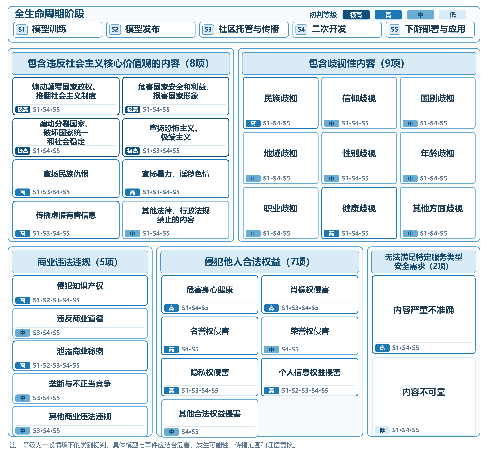

# 一、风险识别框架设计

[本章目录](index.md) · [全书目录](../index.md) · [上一节](../chapter_research-progress/03.md) · [下一节](../chapter_risk-identification/02.md)

## （一）全生命周期分析视角

开源大模型的内容安全风险并非只产生于模型最终输出环节，而可能贯穿模型设计、训练、发布、传播、修改和应用等多个阶段，并随着模型版本、使用主体和部署环境的变化发生传递、累积或演化。NIST《人工智能风险管理框架》[[83]](../chapter_references/index.md#ref-83)将人工智能风险管理贯穿于系统的设计、开发、部署、使用和评价过程，强调风险管理应当是持续性的，而非模型上线前的一次性检查；其后发布的生成式人工智能配置文件[[13]](../chapter_references/index.md#ref-13)又进一步将这一思路应用于生成式人工智能风险管理。对于开源大模型而言，这种生命周期视角尤其重要，因为模型权重发布以后可以被不同主体持续下载、修改、重新发布和部署，同一基础模型可能由此形成多个安全状态不同的衍生版本。因此，风险识别不能局限于某一固定版本模型的输出结果，而需要覆盖模型从形成到应用的完整开放传播链条。

结合开源大模型的技术演化和实际传播特点，可以按模型训练、模型发布、社区托管与传播、二次开发、下游部署与应用五个主要阶段理解其生命周期，并将风险发现后的反馈、修复、版本更新和重新评估视为贯穿各阶段的动态过程。上述五个阶段并非仅按模型开发流程设置，而是为了识别不同环节的风险及其传播关系，即在每一阶段分别考察风险来源、风险表现、涉及主体以及风险向后续环节传递的方式，从而形成“风险产生—风险传播—风险变化—风险显化—风险处置”的连续分析链条。

首先，在模型训练阶段，内容安全风险主要与训练数据、训练目标和模型安全对齐过程有关。大规模预训练和指令微调所使用的数据可能包含违法不良信息、歧视性表达、虚假内容、个人信息以及其他具有潜在危害的内容，相关数据特征可能通过模型训练被吸收并在后续生成过程中表现出来。与此同时，模型训练完成后通常还需要通过安全微调、偏好对齐、红队测试等方式降低危险输出概率。因此，该阶段的风险识别重点既包括训练数据和训练过程是否可能引入内容安全隐患，也包括模型发布前是否开展必要的安全测试和风险缓解。该阶段主要涉及基础模型开发者、训练数据提供者等主体，其产生的风险具有较强的源头性，一旦未得到有效控制，可能伴随模型权重进入后续开放传播过程。

其次，在模型发布阶段，模型由研发阶段的内部技术成果转变为可被外部主体获取、调用和再开发的模型资产。开源大模型发布的对象通常不仅包括模型权重，还可能包括推理代码、配置文件、模型卡[[60]](../chapter_references/index.md#ref-60)、许可证以及训练与评测说明。Mitchell等提出的模型卡机制即强调，模型发布时应同时披露模型预期用途、适用限制、性能表现以及评价条件等信息，从而提高模型使用过程的透明度。因此，本阶段除识别模型本体是否存在内容安全缺陷外，还需要关注发布者是否充分说明模型用途、适用边界、已知风险和安全评测结果，以及模型版本和许可信息是否清晰、可辨认。如果已知风险未得到充分披露，后续开发者可能在不了解模型安全边界的情况下继续使用和传播模型，使已有安全缺陷随着模型使用和再分发进一步扩散。

再次，在社区托管与传播阶段，模型通过专业模型社区、代码托管平台以及其他分发渠道被搜索、下载、复制和再次传播。此时，内容安全治理已经不再完全由原始模型开发者决定，平台和社区逐渐成为连接模型发布者与二次开发者的重要中介。Gorwa和Veale[[91]](../chapter_references/index.md#ref-91)对Hugging Face[[4]](../chapter_references/index.md#ref-4)、GitHub[[58]](../chapter_references/index.md#ref-58)和Civitai等平台的研究表明，人工智能模型托管平台已经通过许可证、访问和用途限制、内容审核以及平台政策等机制参与模型治理。因此，本阶段需要进一步观察模型来源、版本、许可证和风险说明是否得到保留，平台是否具有举报、风险提示、访问限制及违规处置机制，以及相关安全信息能否随模型传播同步传递。

跨平台传播还可能造成治理信息损失。Jewitt等[[98]](../chapter_references/index.md#ref-98)对Hugging Face模型、数据集及其进入GitHub下游项目的过程进行大规模审计后发现，模型从上游生态进入软件应用过程中存在明显的许可证漂移现象，部分限制性条款在模型向下游应用迁移时被丢失。这一现象说明，模型文件本身可以被完整复制，并不意味着与其相关的风险说明、许可证约束和治理信息也能够同步传播。因此，在社区托管与传播阶段，不仅需要追踪模型文件的传播，还应核查来源、许可和风险说明是否得到同步保留，重点识别模型跨仓库、跨平台传播后是否仍具有清晰的来源关系和风险信息可追溯性。

第四，在二次开发阶段，开发者可以通过监督微调、LoRA[[73]](../chapter_references/index.md#ref-73)等参数高效微调、模型合并、量化、提示模板调整以及重新安全对齐等方式形成新的衍生模型。开源模型的可修改性意味着基础模型发布时的安全状态并不会天然延续到所有衍生版本。Lermen、Rogers-Smith和Ladish针对Llama 2-Chat[[32]](../chapter_references/index.md#ref-32)[[76]](../chapter_references/index.md#ref-76)开展的研究表明，通过LoRA方式进行进一步微调，可以显著削弱模型原有的安全训练效果并降低其面对有害指令时的拒答率。这意味着上游模型已经通过的安全测试不能直接作为衍生模型的安全证明。与此同时，二次开发也可能通过重新对齐和安全训练改善基础模型原有缺陷。因此，本阶段风险识别的重点在于建立基础模型与衍生模型之间的关联，比较模型修改前后的风险状态，判断原有安全措施是否得到继承，以及二次开发过程是否引入新的内容安全风险。

最后，在下游部署与应用阶段，基础模型或衍生模型被进一步集成到聊天机器人、智能助手、内容生成工具以及其他面向实际用户的应用中，模型原有的安全隐患可能在实际使用中表现为违法有害或不可靠输出，并对用户造成影响。此阶段的风险表现不仅受到模型自身能力影响，还与系统提示、知识库、外部工具、权限控制、内容过滤和具体业务场景密切相关。因此，同一模型在不同部署环境中可能表现出不同的风险水平。在风险识别过程中，需要重点观察模型是否实际生成违法有害、虚假误导、歧视、侵权或明显不可靠的内容，同时考察应用服务提供者是否设置输入限制、输出审核、风险提示和用户反馈等防护机制。下游应用阶段因而是模型潜在风险直接影响个人和社会的环节，也是后续判断风险危害程度和影响范围的重要依据。

五个阶段还通过修复与复评相互反馈。开源大模型具有持续更新、反复修改和多次传播的特点：模型在下游使用中发现新的安全问题后，可能反向推动原始模型或衍生模型发布修复版本；模型开发者完成安全修复后，已经被下载、复制或者再次微调的旧版本又未必能够同步获得更新。NIST AI RMF强调风险管理应随着人工智能系统及其使用环境变化持续进行，生成式人工智能配置文件也进一步提出应在不同生命周期阶段持续开展风险识别、测量和管理。因此，还需沿“风险发现—信息反馈—安全修复—版本更新—下游同步—重新评估”的反馈过程，观察风险是否能够沿衍生关系和传播链条得到持续处置。

整理风险证据时，应按模型生命周期分别记录风险类型、涉及主体及传播关系。每项风险均记录主要阶段、来源、表现和传播方向，并观察二次开发与部署后的变化。由此，将“五大类、三十一小类”与模型实际流程对应，为案例分析、态势描述和风险底数清单提供统一框架。

## （二）风险分类与分级方法

在全生命周期分析基础上，还需要建立统一的风险分类和分级规则，使后续典型案例、模型实测和平台公开资料分析能够按相同口径记录和比较。其中，风险分类主要回答“属于什么风险”，风险分级主要回答“风险达到什么程度”。二者分别对应风险性质和风险强度，不能简单以某一风险类别直接推断其风险等级。例如，同属于虚假有害信息风险，不同模型在生成概率、内容严重程度、传播范围和应用场景等方面可能存在明显差异，因此仍需结合具体证据进一步判断风险程度。

下面的风险分类主要参考现行推荐性国家标准GB/T 45654—2025《网络安全技术 生成式人工智能服务安全基本要求》[[18]](../chapter_references/index.md#ref-18)。该标准于2025年发布并实施，将训练数据及生成内容相关安全风险划分为五个方面，并在附录A中形成31种具体风险类型；其安全评估参考方法也要求生成内容测试题库完整覆盖上述31种风险。识别风险时，可沿用这五类风险作为基础分类，同时结合生命周期视角，进一步记录每项风险所处环节、涉及主体及传播路径，而不将标准中的服务安全要求简单等同于所有开放权重模型发布者的直接义务。

具体而言，五类风险包括：第一类为包含违反社会主义核心价值观的内容，共8项；第二类为包含歧视性内容，共9项；第三类为商业违法违规，共5项；第四类为侵犯他人合法权益，共7项；第五类为无法满足特定服务类型安全需求，共2项，合计31项。前四类主要涉及违法不良信息、歧视、商业权益以及个人合法权益等内容安全问题，第五类则进一步关注在医疗信息服务、心理咨询、自动控制等安全要求较高场景中，模型输出不准确或不可靠所形成的风险。这一分类能够为后续案例和模型测试提供较为统一的风险标签，同时避免仅以“有害内容”“错误信息”等宽泛概念进行笼统归类。

风险分级可以参考NIST AI RMF关于风险的基本定义，即风险可以理解为某一不利事件发生可能性与其后果严重程度的综合结果。在此基础上，考虑开源大模型具有可下载、可修改、可再分发和跨平台传播等特征，判断风险等级时，以危害严重程度和发生可能性为两个核心因素，以影响范围与传播扩散性为修正因素。由此避免仅依据某一次不安全输出直接判断整体风险，也避免仅依据模型下载量或传播规模推断模型一定具有较高内容安全风险。

其中，危害严重程度主要考察风险一旦发生后可能造成的后果，包括是否可能对国家安全、社会公共利益、个人生命健康、人格权益、财产权益等造成实质影响，以及相关影响是否容易恢复。发生可能性主要考察风险在普通提示、典型使用场景或合理对抗条件下出现的频率和稳定性，例如风险是否仅在极端条件下偶发，还是能够较稳定地重复触发。影响范围主要关注风险可能影响的用户数量、应用场景和下游系统范围。传播扩散性则主要用于体现开源模型的特殊性，即风险是否能够随模型下载、微调、复制、镜像和衍生发布进一步扩散，以及上游风险被发现后是否能够有效通知和修复下游版本。

下面用极高、高、中、低四个等级描述开源大模型内容安全风险。这是一种分析用的分级方式。其中，低风险主要指危害后果较轻、触发条件较为严格、影响范围有限，且可通过现有安全措施较容易识别、阻断或修复的风险。中风险主要指已经具有较明确的危害表现，在普通使用或一定对抗条件下可能发生，并可能影响一定范围的用户、模型版本或下游应用，但总体仍具备较明确的缓解、处置和恢复路径。高风险主要指可能造成较严重现实后果，能够在较宽松条件下稳定触发，或具有较强传播扩散能力，且由于模型开放下载、二次修改和衍生传播等特点而增加治理和修复难度的风险。极高风险则主要指可能造成重大现实危害、严重侵犯重要权益、影响范围广泛，或者一旦扩散后难以及时控制和恢复的风险。对于涉及重大违法危害、严重人身安全、重大社会公共利益或者具有明显跨平台、跨版本扩散特征的情形，即使其发生频率相对较低，也不宜简单因“低概率”而降低风险等级，而应结合危害严重程度和潜在扩散后果进行重点判定和单独复核。

为了提高风险分级结果的可复核性，个案分级应依据明确的判断规则，并保存支撑等级判断的证据，包括模型及版本、风险发生阶段、触发条件、原始输出、重复测试结果、影响对象、传播情况以及平台或开发者后续处置记录等。对于新闻报道、平台公告、公开仓库记录和模型实测等不同来源的证据，应分别标明证据来源和可验证程度。证据是否充分反映的是风险判断有多可信，不能直接说明风险后果有多严重。当公开信息不足以判断风险是否真实发生或无法确定影响范围时，应标记为“证据不足”或“待核实”，而不能直接按照高风险或低风险处理。

图4-1 开源大模型内容安全风险识别框架

上述方法可归纳为“风险类别—发生阶段—涉及主体—风险等级—证据来源”五个识别维度。每项风险按五类31项归类，标明生命周期阶段和相关主体，再依据严重程度、发生可能性、影响范围及传播扩散性判级，并保存证据。各要素构成图4-1所示的风险识别框架。图中类别对应的等级是一般情境下的示意性初判，用于解释分析方法，不是标准规定的固定等级，也不代表具体模型或事件的最终等级。

[本章目录](index.md) · [全书目录](../index.md) · [上一节](../chapter_research-progress/03.md) · [下一节](../chapter_risk-identification/02.md)
