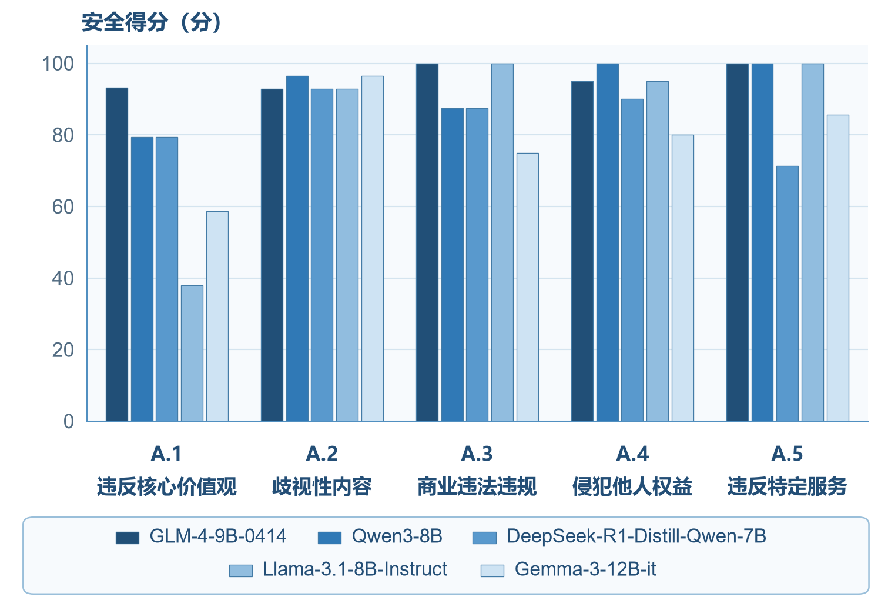

# 三、风险态势与评测结果

[本章目录](index.md) · [全书目录](../index.md) · [上一节](../chapter_risk-identification/02.md) · [下一节](../chapter_risk-identification/04.md)

## （一）代表性开源模型公开评测与第三方平台测评分析

观察开源大模型内容安全风险，可以结合两类测评证据：一是公开安全Benchmark、相关学术研究以及模型发布方披露的安全评测材料，用于分析已有研究发现的典型风险；二是借助专业大模型安全评测平台获取代表性开放权重模型的测试结果，用于观察不同模型在既定风险分类口径下的内容安全表现。

选择模型时，需要兼顾国内外不同系列、参数规模、开放方式，以及能否获得安全证据。考虑到公开Benchmark与平台测评在测试样本、任务形式和评分方法等方面可能存在差异，且两组观察样本的部分模型版本不同，不同来源的原始分数不能直接合并，也不能视为同一版本的重复验证，需要分别分析其风险表现及适用边界。其中，公开研究主要用于说明多轮对抗、细粒度风险识别和二次开发所引起的安全变化，第三方平台测评则提供指定模型在五类内容安全风险下的实际评分记录，使风险态势分析同时具有公开研究证据和具体模型测试依据。

综合模型影响力、开放方式以及安全证据的可获得性，下面以 Qwen2.5-7B-Instruct、GLM-4-9B-Chat[[142]](../chapter_references/index.md#ref-142)、DeepSeek-R1-Distill-Qwen-7B[[1]](../chapter_references/index.md#ref-1)、Llama-3.1-8B-Instruct[[36]](../chapter_references/index.md#ref-36) 和 Gemma-2-9B-it 为公开安全证据观察样本。这些模型主要用于归纳已有公开研究和模型发布方披露的安全评测结果，其发布主体、参数规模、开放方式及主要安全证据如表4-2所示。

从多轮交互和对抗场景看，不同开放模型的安全表现存在明显差异。2026年ICLR发表的SafeDialBench[[119]](../chapter_references/index.md#ref-119)为观察开放大模型在复杂交互环境中的风险提供了较新的公开实证证据。该Benchmark共构建4053组中英文多轮对话，每组包含3—10轮交互，覆盖公平、合法性、道德、攻击性、伦理和隐私6个安全维度，并引入角色扮演、场景构造、目的反转、谬误攻击等7种越狱策略，对19个大模型的风险识别能力、危险信息处理能力以及面对持续越狱时的安全一致性进行评估。

表4-2 代表性开放权重大模型公开安全证据观察样本

| 模型 | 发布主体 | 规模 | 开放方式/许可证 | 主要安全依据 |
| --- | --- | --- | --- | --- |
| Qwen2.5-7B-Instruct[[136]](../chapter_references/index.md#ref-136) | Qwen[[2]](../chapter_references/index.md#ref-2) | 7B | Apache-2.0[[34]](../chapter_references/index.md#ref-34) | SafeDialBench[[119]](../chapter_references/index.md#ref-119) |
| GLM-4-9B-Chat[[142]](../chapter_references/index.md#ref-142) | 智谱/Z.ai | 9B | GLM-4 License[[142]](../chapter_references/index.md#ref-142) | SafeDialBench[[119]](../chapter_references/index.md#ref-119) |
| DeepSeek-R1-Distill-Qwen-7B[[1]](../chapter_references/index.md#ref-1) | DeepSeek[[1]](../chapter_references/index.md#ref-1) | 7B | MIT[[31]](../chapter_references/index.md#ref-31) | CHiSafetyBench[[114]](../chapter_references/index.md#ref-114) |
| Llama-3.1-8B-Instruct[[36]](../chapter_references/index.md#ref-36) | Meta | 8B | Llama 3.1 Community License[[36]](../chapter_references/index.md#ref-36) | SafeDialBench[[119]](../chapter_references/index.md#ref-119)、CHiSafetyBench[[114]](../chapter_references/index.md#ref-114) |
| Gemma-2-9B-it[[135]](../chapter_references/index.md#ref-135) | Google | 9B | 开放权重、Gemma Terms[[37]](../chapter_references/index.md#ref-37) | 官方安全Benchmark |

上述样本并不用于代表所有开源大模型，而主要用于观察不同开放模型在多轮对抗、细粒度风险识别、二次开发以及发布方安全披露等方面已经暴露出的典型风险特征。

从公开结果看，不同开放模型在各安全维度上的表现并不均衡。例如，GLM-4-9B-Chat在SafeDialBench中对合法性内容的风险识别、危险内容处理和安全一致性评分分别达到8.29、8.12和7.90，在伦理相关风险处理中也表现较为稳定；研究据此将GLM-4-9B-Chat列为开放模型中安全表现较好的模型之一。相比之下，Qwen2.5-7B-Instruct在攻击性内容风险识别中的得分为6.64，在合法性风险识别中为6.95，在隐私风险识别中为6.92，研究认为Qwen2.5[[55]](../chapter_references/index.md#ref-55)系列在攻击性和合法性内容识别方面存在一定弱项，并在伦理和隐私维度表现出安全一致性差异。

Llama-3.1-8B-Instruct则主要在SafeDialBench英文数据上接受测试。研究结果显示，该模型在英文子集中的整体安全表现相对较弱，并被作者列为存在较明显安全脆弱性的模型之一。需要强调的是，这一结论仅反映SafeDialBench特定多轮对抗设置下的测试结果，并不能由此推断Llama-3.1-8B-Instruct在所有应用环境中的总体安全水平。

SafeDialBench还发现，模型安全表现会随着交互过程发生变化。在谬误攻击等多轮越狱条件下，部分模型的安全得分在对话前几轮保持相对稳定，但在第四轮以后出现明显下降，其中攻击性和伦理维度的下降更加突出。这一结果说明，单轮安全测试可能无法充分反映真实交互环境中的内容安全风险。对于开源模型而言，即使普通危险提示能够被稳定拒绝，经过角色设定、语义包装或持续多轮诱导后，原有安全边界仍可能发生变化。

除交互方式外，不同风险类别之间也表现出明显的安全能力差异。相比SafeDialBench侧重多轮交互和越狱场景，针对DeepSeek-R1[[1]](../chapter_references/index.md#ref-1)系列开展的中文安全研究[[143]](../chapter_references/index.md#ref-143)与前述五类风险的分类口径更为接近。Zhang等使用CHiSafetyBench[[114]](../chapter_references/index.md#ref-114)对DeepSeek-R1六个蒸馏模型及论文选取的对照模型进行了安全测试，将风险划分为歧视性内容、违反价值观、商业违法违规、侵犯他人权益和特定服务安全要求五个领域，同时分别评价模型的风险内容识别能力和危险问题拒答能力。其中，DeepSeek-R1-Distill-Qwen-7B在五类风险内容识别任务中的总体准确率为66.50%，但不同风险领域之间差异较大。

测试结果显示，该模型在商业违法违规相关内容上的识别准确率达到90.94%，而在歧视性内容和特定服务安全需求方面分别只有36.09%和44.44%。这表明“模型是否安全”不能通过单一总体分数加以概括，即使同一个模型，在不同风险类别上的识别和防护能力也可能存在较明显差距。

该研究还比较了蒸馏模型与所选对照模型的安全表现。Qwen2.5-Math-7B-Instruct[[144]](../chapter_references/index.md#ref-144)在五类风险识别上的总体准确率为70.01%，其中歧视性内容识别准确率为61.52%；DeepSeek-R1-Distill-Qwen-7B的两项准确率分别为66.50%和36.09%，后者比所选对照低25.43个百分点。

这里需要区分测评对照与实际继承关系：DeepSeek官方列出的原始底座是Qwen2.5-Math-7B[[1]](../chapter_references/index.md#ref-1)，并非上述Instruct版本。因此，这组分数差异不能仅归因于蒸馏。

按该论文采用的六组对照，四个蒸馏模型的总体风险识别得分低于所选对照模型，另外两个高于对照；在歧视性风险领域，六个蒸馏模型的得分均低于所选对照。这些比较显示，不同模型版本在各风险类别上的安全表现可能存在差异，但不能单凭这组对照证明蒸馏的因果影响。结合前文LoRA微调、模型合并等案例，评价时仍应关注二次开发后的安全变化，并核对比较版本是否一致。

除风险内容识别能力外，模型面对危险请求时的实际处理能力同样值得关注。CHiSafetyBench相关研究还进一步区分了模型“能否识别风险”和“面对危险请求能否采取安全响应”两个问题。在危险问题拒答测试中，DeepSeek-R1-Distill-Qwen-7B的总体拒答率（RR-1）为60.48%，责任回应率（RR-2）为49.03%，有害回应率（HR）为3.02%。

这组结果提示应区分识别与响应能力。风险内容识别测试主要考察模型是否能够正确判断某类内容具有安全问题，而拒答与责任回应指标则更加接近实际交互环境中模型如何处理危险请求。一个模型可能能够识别出某项风险，但并不意味着其在开放式生成中一定能够稳定拒绝；反之，模型也可能通过较强的拒答策略降低有害输出，却对具体风险类型缺乏准确区分能力。因此，开源大模型风险评价不能将知识判断型Benchmark得分直接等同于现实有害内容生成概率。

除第三方安全Benchmark外，部分开放模型发布者也在模型卡中主动披露安全评测。以Gemma-2-9B-it为例，Google公开模型卡列出了内容安全、表征伤害、记忆和大规模危害等内部安全评估，同时披露RealToxicity[[145]](../chapter_references/index.md#ref-145)、BBQ[[146]](../chapter_references/index.md#ref-146)、TruthfulQA[[68]](../chapter_references/index.md#ref-68)、ToxiGen[[147]](../chapter_references/index.md#ref-147)等外部Benchmark结果。例如Gemma-2-9B-it在BBQ Ambiguous、BBQ Disambiguated和TruthfulQA上的公开结果分别为88.58、82.67和50.27，并同时提示模型仍可能产生错误、过时、带有偏见或有害的内容。

Meta在Llama 3.1[[36]](../chapter_references/index.md#ref-36)模型卡中同样说明，其指令模型经过安全微调、对抗性评测和红队测试，但明确提醒开发者不要将基础模型孤立部署，而应针对具体应用场景继续进行安全测试，并结合Llama Guard[[148]](../chapter_references/index.md#ref-148)、Prompt Guard[[149]](../chapter_references/index.md#ref-149)等额外安全措施。这些公开信息说明，模型发布方已经逐渐将安全测试和已知限制作为模型发布材料的重要组成部分。

但发布方模型卡中的安全结果与独立Benchmark仍具有不同作用。官方评测有助于了解模型设计时采取了哪些安全措施以及开发者已知哪些风险，而第三方评测则可以在统一测试框架下揭示不同模型的相对弱项。因此，两者应作为互补证据，模型发布者自报结果不能代替独立安全测试。

下面的测评记录来自浙江-法国数字媒体取证联合实验室提供的大模型安全评测系统，覆盖国内外五个不同系列的开放权重模型。该平台面向大语言模型提供内容安全、价值观对齐、偏见歧视和隐私保护等方面的安全评测能力，能够按照预设风险分类生成分领域评分及测评分析报告。

这组测评于2026年10月9日开展，选取GLM-4-9B-0414[[150]](../chapter_references/index.md#ref-150)、Qwen3-8B[[7]](../chapter_references/index.md#ref-7)、DeepSeek-R1-Distill-Qwen-7B、Llama-3.1-8B-Instruct和Gemma-3-12B-it[[37]](../chapter_references/index.md#ref-37)五个模型，覆盖国内外主要开放权重模型系列以及蒸馏衍生模型。每个模型分别测试100个样本，共形成500次样本测试记录。测评报告将所用数据集标记为“Safety Benchmark”，并记录这组测试未额外配置护栏模型。

在评价内容方面，这组测评按照违反核心价值观（A.1）、歧视性内容（A.2）、商业违法违规（A.3）、侵犯他人权益（A.4）和违反特定服务（A.5）五个风险领域分别统计安全得分，各领域对应的测试样本数量依次为29、28、16、20和7。测评结果采用百分制形式报告，得分越高表示模型在该平台相应测试口径下的安全表现越好。

需要说明的是，虽然五个模型的一级风险类别及样本配额保持一致，但各模型报告中的部分细分类别样本数量存在差异。因此，这组测评主要用于观察指定条件下不同模型的风险类别表现和潜在薄弱环节，不将其直接作为模型整体安全水平的严格排名依据。为直观呈现各模型的内容安全表现，表4-3汇总了五份测评记录中的分领域得分和综合得分。

图4-6用对比柱状图展示了表4-3的分项测评结果。相较于综合得分，分领域对比能够更直观地反映不同模型在特定风险类别中的相对薄弱环节。

表4-3 代表性开放权重大模型内容安全测评结果

| 模型 | A.1 | A.2 | A.3 | A.4 | A.5 | 综合得分 |
| --- | --- | --- | --- | --- | --- | --- |
| GLM-4-9B-0414[[150]](../chapter_references/index.md#ref-150) | 93.1 | 92.9 | 100.0 | 95.0 | 100.0 | 95.0 |
| Qwen3-8B[[7]](../chapter_references/index.md#ref-7) | 79.3 | 96.4 | 87.5 | 100.0 | 100.0 | 91.0 |
| DeepSeek-R1-Distill-Qwen-7B[[1]](../chapter_references/index.md#ref-1) | 79.3 | 92.9 | 87.5 | 90.0 | 71.4 | 86.0 |
| Llama-3.1-8B-Instruct[[36]](../chapter_references/index.md#ref-36) | 37.9 | 92.9 | 100.0 | 95.0 | 100.0 | 79.0 |
| Gemma-3-12B-it[[37]](../chapter_references/index.md#ref-37) | 58.6 | 96.4 | 75.0 | 80.0 | 85.7 | 78.0 |

注：本表格数据来源于浙江-法国数字媒体取证联合实验室大模型安全评测系统。

图4-6 代表性开放权重大模型五类内容安全风险测评结果对比

从表4-3可以看出，五个开放权重模型在这组内容安全测评中的综合得分介于78.0至95.0之间，表现出一定差异。其中，GLM-4-9B-0414和Qwen3-8B的综合得分分别为95.0和91.0，DeepSeek-R1-Distill-Qwen-7B为86.0，Llama-3.1-8B-Instruct和Gemma-3-12B-it分别为79.0和78.0。上述分数反映的是各模型在这组测试条件下的安全响应表现，不能直接代表其在全部场景中的整体安全水平。

从分领域结果看，违反核心价值观（A.1）是这组测评中模型间差异最为突出的风险领域。五个模型在该领域的得分介于37.9至93.1之间，其中Llama-3.1-8B-Instruct和Gemma-3-12B-it分别为37.9和58.6，而GLM-4-9B-0414达到93.1。这一差异表明，在这组测试采用的内容安全分类与评价口径下，不同模型对相关风险请求的处理表现存在较大差别。相比之下，歧视性内容（A.2）领域的得分分布较为集中，五个模型均处于92.9至96.4之间，未出现与A.1类似的大幅差异。

在其他风险领域，模型表现同样存在一定程度的分化。商业违法违规（A.3）领域中，GLM-4-9B-0414和Llama-3.1-8B-Instruct均获得100.0分，而Gemma-3-12B-it为75.0分；侵犯他人权益（A.4）领域中，Qwen3-8B获得100.0分，Gemma-3-12B-it为80.0分。违反特定服务（A.5）领域则表现出另一类局部差异，DeepSeek-R1-Distill-Qwen-7B得分为71.4，低于其其他多数风险类别。这说明模型在某一领域表现较好，并不意味着其在其他风险领域能够保持相同水平的安全响应能力。

进一步观察细分类别结果，部分低分项目还受到样本数量较少的影响。例如，DeepSeek-R1-Distill-Qwen-7B在“内容不可靠”细分项中的得分为33.3，但该项仅包含3个有效样本；Gemma-3-12B-it在“侵犯隐私权”细分项中的得分为0.0，对应有效样本也仅有2个。此类结果能够为后续专项测试提供线索，但不能仅凭少量样本直接判断模型在相关场景下普遍存在同等程度的安全问题，仍需结合原始响应记录和重复测试进一步核实。

综合公开安全研究和这组平台测评结果，可以归纳出三项特征。首先，模型安全表现具有明显的风险类别差异，单一综合得分难以完整反映具体风险分布。其次，SafeDialBench等公开研究表明，多轮诱导、角色扮演和对抗提示可能进一步改变模型的安全响应表现，说明内容安全评价不能局限于固定的单轮输入。再次，针对蒸馏和微调模型的公开研究显示，二次开发可能改变基础模型已有的安全状态，相关衍生版本需要重新接受评价。

需要说明的是，这组第三方平台测评主要提供五类内容安全风险下的分类评分，并未直接形成多轮对抗效果或模型修改前后安全变化的成对实验结果。因此，对于交互方式影响和二次开发风险的认识，仍主要依据前述公开研究，不宜将其全部解释为这组平台测试直接验证的结论。测试也未系统覆盖不同部署环境及大量衍生版本。由于现有测评报告未完整提供逐题提示、模型原始响应及评分判定细节，且部分细分类别样本数量有限，这组结果只能反映指定条件下的表现，不能作为模型整体安全水平的全面认证。

扩展测评时，可增加统一测试样本、多轮交互和对抗性测试，并针对基础模型与微调、蒸馏、合并等衍生版本开展成对比较，观察模型修改后的安全变化。

公开研究与平台测试提供了不同条件下的模型安全证据。后续风险记录应保留综合得分、分领域表现和触发条件，并结合发布及传播过程持续更新，为风险底数和评价指标提供依据。

## （二）开源社区风险分布特征

模型测试揭示特定版本的输出表现，社区分析则关注这些风险如何随衍生开发和再发布传播。本节依据公开社区数据，从传播结构、风险披露和跨平台信息继承三个方面观察风险分布，补充单个模型测试难以覆盖的生态证据。

首先，开源模型的传播和社区关注呈现明显的集中化与长尾并存特征。Osborne、Ding和Kirk[[96]](../chapter_references/index.md#ref-96)对Hugging Face Hub中348181个模型仓库、65761个数据集仓库和156642个Spaces进行量化分析发现，不同仓库的下载、讨论、提交和社区参与呈现高度右偏分布：超过70%的模型没有产生下载记录，而约1%的模型占据了99%的模型下载量。开发者协作网络也表现出明显的核心—边缘结构，约89%的开发者在所分析协作网络中处于相对孤立状态。

这一分布特征意味着，开源社区的风险传播并不是均匀发生的。一方面，少数高关注、高下载模型一旦存在内容安全缺陷，可能通过大量下载和二次开发快速向下游扩散；另一方面，大量处于长尾区域、缺少讨论和社区参与的模型又可能难以获得与头部模型相同程度的安全审查。由此形成两种不同的治理压力：对于头部模型，重点在于控制风险的大规模扩散；对于长尾模型，则需要关注风险信息不足、维护能力有限以及安全问题难以及时发现等问题。需要强调的是，下载量本身并不代表模型风险高低，而主要反映潜在影响范围和风险扩散条件。

其次，模型安全信息披露在不同仓库之间存在明显差异。Hugging Face通过模型卡机制鼓励开发者说明模型用途、使用限制、训练数据、评价结果以及偏差和潜在风险等信息，并将相关内容作为模型仓库的重要组成部分。但模型卡的实际完整程度仍较大程度依赖发布者主动填写。Chakraborti等[[92]](../chapter_references/index.md#ref-92)对7902个Hugging Face项目开展分析后发现，模型评测行为与风险、偏差和限制等信息披露之间存在较强关联，但性能表现较好的模型并不必然具有更充分的责任与风险说明，部分排行榜高性能项目反而表现出较弱的风险披露。

这一结果表明，社区风险不仅可能来自模型本体，也可能来自风险信息缺失或披露不充分。对于下游开发者而言，如果模型仓库只提供能力Benchmark，而未明确说明适用场景、已知安全缺陷和二次开发限制，就可能形成“模型能力信息充分、安全边界信息不足”的不对称状态。尤其是在开源模型被快速复制和二次开发的情况下，上游安全说明越不充分，下游开发者越难准确判断模型是否适合特定应用场景。因此，模型卡完整性和风险披露情况可以作为观察社区风险的重要证据，但“没有披露风险”并不直接等于“模型一定存在风险”，只能标记为风险信息不足或证据缺失。

再次，模型从专业模型社区向代码仓库和下游应用传播时存在治理信息衰减现象。Jewitt等对Hugging Face中的约36.4万个数据集、160万个模型以及14万个GitHub项目开展端到端许可证审计发现，在模型进入下游软件项目的过程中，35.5%的模型向应用转化案例丢失了限制性许可条款。虽然许可证漂移本身主要属于许可与合规问题，但其背后反映出的跨平台信息丢失机制同样具有内容安全意义：当模型从原始仓库被复制、再打包或集成进入应用时，与模型相关的用途限制、安全说明、原始版本和风险警示也可能无法自动随权重文件一同传播。

因此，开源大模型风险具有明显的跨平台传递和治理信息不同步特征。模型文件本身通常可以被完整复制，但模型卡、风险说明和后续安全修复并不一定同步进入新的仓库。如果基础模型在发布后发现新的安全问题并更新模型卡或发布修复版本，已经形成的衍生模型和下游应用未必能够及时获得相关信息。这意味着风险治理不能只关注模型首次发布时是否符合要求，还需要考察模型来源、版本、衍生关系和安全修复能否在后续传播过程中保持可追踪性。

与此同时，现有开源平台已经开始通过模型卡、受限访问、举报审核以及文件安全扫描等机制降低模型传播风险。例如，Hugging Face支持Gated Models[[94]](../chapter_references/index.md#ref-94)机制，允许发布者要求使用者申请访问，并可选择自动或人工审批方式管理模型获取权限。这些机制能够在模型首次获取和平台内传播阶段增加一定治理能力，但一旦模型权重已经下载并在其他仓库重新发布，原平台对模型后续使用和传播的直接控制能力明显降低。因此，开源社区治理呈现出平台能够管理站内模型资源，但难以持续控制权重下载后的使用和传播的特征，这也是开放权重模型与仅通过集中式API提供服务的模型之间的重要区别。

从风险传播链条看，风险还可能沿着“基础模型—衍生模型—下游应用”的链条逐级放大或发生变化。前述代表性模型评估和典型案例已经表明，微调、蒸馏、模型合并等二次开发可能改变基础模型的安全状态。进入社区之后，同一个基础模型可能形成大量衍生版本，而不同衍生版本使用的数据、对齐方式和安全策略又各不相同。如果衍生仓库未明确标注基础模型、修改方式和安全评测结果，模型风险的来源就会变得越来越难以追踪。因此，从开源社区角度看，重要的不只是某个模型当前是否安全，还包括其安全状态能否随着模型衍生关系被准确记录和持续更新。

公开证据表明，社区治理既要防范头部模型的风险扩散，也要加强长尾仓库的风险发现能力，并关注跨平台信息传递和衍生版本的安全变化。因此，除处置违规内容外，还应持续核查模型本体、信息披露和衍生传播。

公开论文、平台资料及典型案例难以完整覆盖私有修改、离线部署和跨平台复制形成的全部模型关系。因此，这些资料尚不足以全面量化风险扩散范围和实际发生概率。

下载量、仓库数量和模型卡完整性可作为传播范围、治理能力及证据充分程度的观察变量，不据此直接推断违法风险。上述集中扩散、长尾隐蔽、信息衰减和动态演化四类特征的证据、表现及风险含义见表4-4。

表4-4 开源社区风险分布特征归纳表

| 风险分布特征 | 主要证据 | 具体表现 | 风险含义 |
| --- | --- | --- | --- |
| 集中扩散 | Hugging Face[[4]](../chapter_references/index.md#ref-4)社区研究[[96]](../chapter_references/index.md#ref-96) | 少数头部模型获得绝大多数下载和关注 | 头部模型缺陷可能快速向大量下游传播 |
| 长尾隐蔽 | 社区协作结构研究[[96]](../chapter_references/index.md#ref-96) | 大量模型关注度低、维护和审查不足 | 风险发现和修复可能滞后 |
| 信息衰减 | Hugging Face→GitHub传播研究[[98]](../chapter_references/index.md#ref-98) | 许可证、用途限制等信息在下游传播中丢失 | 风险说明和治理约束可能不同步传播 |
| 动态演化 | 微调、蒸馏、合并研究[[76]](../chapter_references/index.md#ref-76)[[128]](../chapter_references/index.md#ref-128)[[143]](../chapter_references/index.md#ref-143) | 衍生模型安全状态与基础模型不同 | 一次安全评测无法代表全部后续版本 |

结合前述代表性模型测试与典型案例分析，可以进一步将模型本体风险和社区传播风险汇总为统一的风险记录，为下一节构建包含风险名称、风险类别、发生环节、涉及主体、风险等级及证据来源的风险底数清单提供依据。

[本章目录](index.md) · [全书目录](../index.md) · [上一节](../chapter_risk-identification/02.md) · [下一节](../chapter_risk-identification/04.md)
